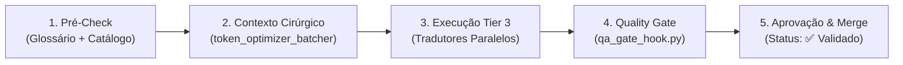

# ⚡ Skill: Sprint de Tradução Multi-Agente (`gba-translate-sprint`)

Este playbook aplica o fluxo de estúdio do *Claude-Code-Game-Studios* combinado com o [Protocolo Mestre de Tradução](../../02_TRADUCAO_ROMS_GBA/protocolo_traducao/PROTOCOLO_MESTRE_TRADUCAO.md) para traduzir lotes de ROMs com máxima qualidade literária e zero estouro de memória/tela.

## 🔄 Fluxo Operacional da Sprint



### Passo 1: Pré-Check de Contexto (Tier 1 & Tier 2)
Antes de traduzir o arquivo `.md` alvo:
1. Leia os termos relevantes em `02-glossario-e-terminologias.md` (e `GLOSSARIO_GLOBAL_SUMMON_NIGHT.md` se for da série *Summon Night*).
2. Consulte as vozes dos falantes presentes no arquivo em `catalogo-de-personagens.md`.
3. Se o arquivo tiver mais de 60 linhas pendentes, você pode usar `token_optimizer_batcher.py` para gerar blocos enxutos de 35-50 falas ou dividir por faixas de linhas entre subagentes (`gba-dialogue-translator`).

### Passo 2: Diretrizes Obrigatórias Durante a Tradução (Tier 3)
Ao preencher a coluna `Tradução Sugerida (PT-BR)`:
1. **Limite Físico de Tela:** Mantenha cada linha entre `<br>` idealmente entre **1 e 32 caracteres** (Soft Limit: **33-35 chars**; Hard Limit absoluto: **35-36 chars** dependendo do jogo).
2. **Neutralidade de Gênero para `{PLAYER}`:** Jamais use adjetivos masculinos/femininos diretos para o protagonista compartilhado. Use construções com substantivos (*"Você tem muita coragem!"*, *"O cansaço bateu?"*, *"Boas-vindas!"*, *"Agradeço de coração!"*).
3. **Zero Inglês Residual:** Traduza todos os termos comuns e compostos (*Guilda Prateada*, *Torre Central*, *Cidade das Espadas*), mantendo no original apenas nomes próprios de pessoas e continentes/cidades puras.
4. **Política de Abreviações:**
   - **Diálogos de História:** Zero abreviações (`vc`, `tb`, `pq`, `atq.` são estritamente proibidos).
   - **Menus e Itens (`03-` e `06-`):** Use a Tabela Canônica (`ATQ`, `DEF`, `AGI`, `DUR`, `HP`, `Recup.`, `Esp.`, `Mach.`, `Lanç.`, `Soq.`, `Broc.`, `Min.`, `Nv.`).
5. **Prevenção de Orfandade:** Nunca termine uma linha antes de `<br>` com monossílabos soltos (`o`, `a`, `de`, `do`, `da`, `em`, `e`, `que`).

### Passo 3: Passagem Obrigatória pelo Quality Gate (Tier 2/3)
Assim que terminar a tradução do lote/arquivo, **sempre** execute o auditor automatizado:
```powershell
python "02_TRADUCAO_ROMS_GBA/protocolo_extracao/tools/qa_gate_hook.py" "<caminho_do_arquivo.md>" -l 35
```
- Se o `qa_gate_hook.py` apontar qualquer erro `🔴 [FAIL]` (estouro de caracteres, tag `{PLAYER}` faltando ou abreviação proibida), **reescreva imediatamente as linhas sinalizadas** e rode o comando de novo até obter `🏆 QUALITY GATE APROVADO!`.
