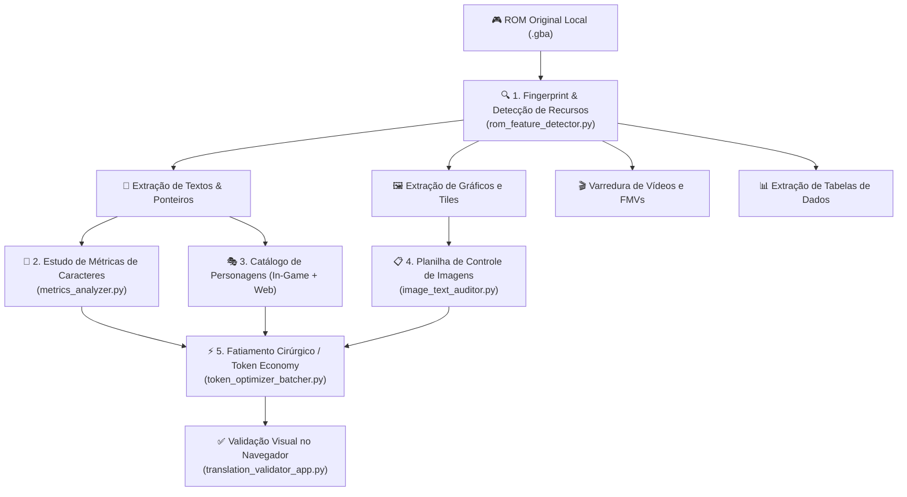

# 🕹️ ROMs Translation Framework & Protocol — Suíte de Processos e Engenharia

> [!NOTE]
> ### ⚖️ Aviso Legal & Filosofia do Repositório (Processos Apenas)
> - **Repositório Exclusivo de Processos e Ferramental:** Este repositório é um **framework de engenharia e processos**. Ele contém exclusivamente diretrizes metodológicas, especificações de protocolo, templates padronizados, scripts de automação e utilitários de validação.
> - **Nenhum Dado de Jogo Específico Versionado:** **Nenhum script traduzido, banco de dados de jogo específico, imagem comercial ou patch de jogo é mantido neste repositório**. Todas as pastas criadas para jogos individuais sob `jogos/` são mantidas estritamente em ambiente local e ignoradas pelo Git.
> - **Zero Tolerância para Distribuição de ROMs:** Este projeto **NÃO contém, não hospeda e NÃO disponibiliza nenhum arquivo de ROM comercial protegido por copyright**. O usuário opera localmente com suas próprias cópias legítimas.
> - **Direitos Autorais:** Marcas, nomes e elementos de propriedades intelectuais originais citados a título de estudo pertencem aos seus respectivos estúdios e publicadores (Nintendo, Banpresto, Konami, Atlus, Capcom, etc.).

---

Este repositório reúne a metodologia oficial, os protocolos de extração estruturada e as ferramentas modulares para localização e tradução de ROMs retrô (com foco primário em **Game Boy Advance** e arquitetura extensível para **SNES, Mega Drive, NDS e PS1**), otimizados para fluxo de trabalho de alta performance e **economia de tokens** com Inteligência Artificial (Google Antigravity / DeepMind).

---

## 📂 Arquitetura do Repositório

O repositório é enxuto e preserva apenas o pipeline operacional de desenvolvimento:

```
gba-roms-translator-ptbr/
│
├── 📁 protocolo_extracao/        # 📜 PROTOCOLO MESTRE & ENGENHARIA DE EXTRAÇÃO
│   ├── PROTOCOLO_MESTRE_EXTRACAO.md # Manual técnico integral (Normas, VRAM, Multi-Console)
│   ├── README.md                 # Guia de início rápido da suíte
│   │
│   ├── 📁 templates/             # Modelos oficiais prontos (.md)
│   │   ├── 02-glossario-e-terminologias.template.md
│   │   ├── 03-mensagens-do-sistema.template.md
│   │   ├── 06-itens-equipamentos-e-descricoes.template.md
│   │   ├── catalogo-de-personagens.template.md
│   │   ├── estudo-de-metricas-e-caracteres.template.md
│   │   ├── controle-de-imagens-com-texto.template.md
│   │   └── relatorio-extracao.template.md
│   │
│   └── 📁 tools/                 # Ferramentas CLI em Python (Core do Protocolo)
│       ├── metrics_analyzer.py        # Análise estatística de limites de caracteres e overflow
│       ├── rom_feature_detector.py    # Fingerprint, detecção de compressão e vídeos (Mobiclip)
│       ├── image_text_auditor.py      # Catalogação e auditoria de integridade de imagens/paleta
│       └── token_optimizer_batcher.py # Fatiador com injeção cirúrgica de contexto (Token Economy)
│
├── 📁 _ferramentas_gerais/       # Softwares utilitários independentes de plataforma
│   ├── mGBA/                    # Emulador de precisão com depurador integrado
│   └── crystaltile2/            # Editor hexadecimal e visualizador de padrões gráficos
│
├── 📁 jogos/                     # Workspace local para projetos de jogos
│   │
│   └── 📁 _MODELO_NOVO_JOGO/    # Template mestre padronizado para iniciar novos projetos
│       ├── ARQUIVOS md/         # Modelos pré-carregados de Glossário, Sistema, Itens e Catálogo
│       ├── docs/                # Relatório técnico padrão
│       ├── releases/            # Pasta destino de patches locais
│       ├── rom/                 # Local para inserção da ROM original local
│       ├── tools/               # Validador web integrado (App interativo + UI)
│       ├── Compilar_ROM_PTBR.bat        # Atalho de build local
│       ├── Iniciar_Validador_Traducao.bat # Atalho para interface web local
│       └── README.md            # Guia passo a passo do novo jogo
│
├── .gitignore                   # Blindagem estrita (ignora jogos/*, ROMs, zips, saves e backups)
└── README.md                    # Esta documentação
```

---

## ⚡ 1. O Protocolo Mestre de Extração e Tradução

O **[Protocolo Mestre de Extração](protocolo_extracao/PROTOCOLO_MESTRE_EXTRACAO.md)** padroniza todo o ciclo de vida da localização de uma ROM em 5 pilares fundamentais:



### Os 5 Pilares do Protocolo:
1. **Textos Estruturados em Markdown:** Todos os textos do jogo são organizados em tabelas compatíveis com o validador web interativo, mantendo arquivos essenciais obrigatórios: Glossário (`02-`), Mensagens de Sistema (`03-`), Itens e Equipamentos (`06-`) e Lotes sequenciais de história.
2. **Estudo de Métricas e Limites de Linha:** Análise matemática da largura em pixels das caixas de diálogo e das fontes do jogo. Define zonas de segurança: **Ideal (1 a 32 chars)**, **Soft Limit (33 a 35 chars)** e **Hard Limit (36+ chars / overflow)**, com quebra manual estrita via `<br>`.
3. **Catálogo de Personagens com Biografia Híbrida:** Mescla dados extraídos da ROM com pesquisa em fontes canônicas oficiais (artbooks, wikis) para balizar o **Tom de Voz**, idioleto, registro de fala (formal, coloquial, rústico, sarcástico) e maneirismos.
4. **Imagens com Texto Auditadas:** Rastreamento rigoroso de gráficos que contêm textos desenhados (Title, Game Over, Menus). O protocolo audita resoluções em pixels e proíbe o uso do índice 0 da paleta (transparência de hardware).
5. **Varredura de Vídeos e FMVs:** Detecção de codecs de vídeo (Mobiclip `MOC4`/`MOC5`, Actimagine) com estudo prévio de viabilidade entre *hardsub* ou *softsub overlay*.

---

## 💡 2. Estratégia de Economia de Tokens (*Token Economy*)

Dumps brutos de ROMs contendo milhares de linhas descontextualizadas geram desperdício massivo de tokens e alucinações terminológicas em Modelos de Linguagem (LLMs). O utilitário [`token_optimizer_batcher.py`](protocolo_extracao/tools/token_optimizer_batcher.py) resolve isso aplicando o **Princípio do Contexto Cirúrgico**:

* **Fatiamento em Lotes Ideais:** Divide os diálogos em blocos compactos de 30 a 50 caixas de fala.
* **Injeção Dinâmica de Glossário:** O prompt contém **apenas** os termos que de fato aparecem no lote sendo traduzido.
* **Personagens Ativos Apenas:** Apenas os perfis dos personagens que falam no trecho são incluídos no contexto.
* **Retorno em Tabela Compacta:** O modelo devolve apenas as colunas de tradução indexadas, alcançando até **75% de economia de tokens** por interação.

---

## 🛠️ 3. Catálogo das Ferramentas CLI do Framework

Todas as ferramentas foram desenvolvidas em **Python 3** (sem dependências externas obrigatórias):

| Ferramenta | Comando de Exemplo | Finalidade |
| :--- | :--- | :--- |
| **`rom_feature_detector.py`** | `python protocolo_extracao/tools/rom_feature_detector.py rom/jogo.gba -o docs/relatorio.md` | Detecta serial oficial, compressões BIOS (LZ77/Huffman), tabelas de ponteiros e vídeos FMV. |
| **`metrics_analyzer.py`** | `python protocolo_extracao/tools/metrics_analyzer.py -d "ARQUIVOS md" -g "Jogo" -l 36` | Analisa limites de caracteres, quebras `<br>`, calcula médias e sinaliza falas com risco de overflow. |
| **`image_text_auditor.py`** | `python protocolo_extracao/tools/image_text_auditor.py -d "extracted/graphics" -o "controle-imagens.md"` | Mapeia dimensões e paletas de PNGs e audita imagens editadas antes da reinjeção na ROM. |
| **`token_optimizer_batcher.py`** | `python protocolo_extracao/tools/token_optimizer_batcher.py "ARQUIVOS md/08-dialogos.md" -s 35` | Gera prompts enxutos de alta densidade informacional para tradução assistida por IA. |
| **`translation_validator_app.py`** | `python tools/translation_validator_app.py` *(dentro do projeto)* | Servidor web local com interface visual simulando a tela de diálogo do GBA em tempo real. |

---

## 🚀 4. Como Iniciar um Novo Projeto de Tradução (Localmente)

1. **Clone o repositório:**
   ```bash
   git clone https://github.com/ewertonhseixas/gba-roms-translator-ptbr.git
   cd gba-roms-translator-ptbr
   ```

2. **Crie a pasta do seu novo jogo duplicando o template:**
   * Copie a pasta `jogos/_MODELO_NOVO_JOGO/` para dentro de `jogos/` com o nome do seu jogo (ex: `jogos/Meu_Jogo_GBA/`).
   * *(Nota: Graças ao `.gitignore`, a nova pasta ficará ativa apenas no seu computador local, sem poluir o repositório).*

3. **Insira sua ROM original:**
   * Coloque a sua cópia legal da ROM `.gba` na pasta `jogos/Meu_Jogo_GBA/rom/`.

4. **Execute as etapas do Protocolo:**
   * Rode o `rom_feature_detector.py` para gerar o relatório de auditoria inicial em `docs/relatorio-extracao.md`.
   * Realize a extração dos textos para os templates Markdown em `ARQUIVOS md/`.
   * Calibre as medidas executando `metrics_analyzer.py`.
   * Traduza utilizando o validador interativo (`Iniciar_Validador_Traducao.bat`) ou com auxílio do particionador de IA (`token_optimizer_batcher.py`).
   * Compile a ROM e o patch localmente com `Compilar_ROM_PTBR.bat`.

---

## 🌐 5. Extensibilidade Multi-Console

Embora o Game Boy Advance seja o foco primordial da arquitetura atual, a suíte foi projetada em camadas desacopladas para permitir extensão direta para outros consoles clássicos:

* **Super Nintendo (SNES):** Mapeamento de 24 bits (LoROM/HiROM), fontes 1bpp/2bpp e compressões HAL/Nintendo LZ.
* **Mega Drive / Genesis:** Arquitetura Motorola 68000 Big-Endian, compressões Nemesis/Kosinski e paletas de 64 cores.
* **Nintendo DS (NDS):** Sistema de arquivos interno NARC/SDAT, fontes nativas NFTR e vídeos Mobiclip VX.
* **PlayStation (PS1):** Sistema de arquivos ISO 9660, texturas TIM, vídeos MDEC (STR) e ponteiros Little-Endian MIPS.
