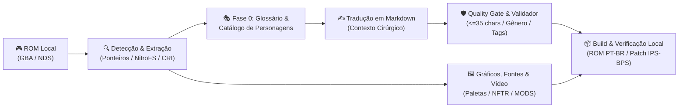

<div align="center">

# 🕹️ ROMs Translator PT-BR — Localization Studio & Engineering Framework

**Suíte modular de protocolos, automação e engenharia reversa para localização de jogos retrô (GBA & NDS) em Português do Brasil.**

[](#arquitetura-do-repositório)
[](#ferramentas-e-utilitários)
[](#protocolos-e-governança)
[](#aviso-legal)

</div>

---

<a id="aviso-legal"></a>

> [!NOTE]
> ### ⚖️ Aviso Legal & Filosofia do Repositório (Projeto Feito por Fã — Processos Apenas)
> - **Projeto Independente Feito por Fã:** Este é um projeto não oficial, independente e **sem fins lucrativos**, desenvolvido por fã com propósito exclusivamente educacional, de pesquisa técnica em engenharia reversa e preservação cultural. Não possui qualquer afiliação, endosso ou vínculo com as detentoras dos direitos originais.
> - **Repositório Exclusivo de Processos e Ferramental:** Este repositório é um **framework de engenharia e processos**. Ele contém exclusivamente diretrizes metodológicas, especificações de protocolo, templates padronizados, scripts de automação e utilitários de validação/edição.
> - **Nenhum Dado de Jogo Comercial Versionado:** **Nenhuma ROM, mídia extraída, imagem comercial, build ou patch de jogo é mantido neste repositório**. As pastas de trabalho locais com insumos e arquivos extraídos dos jogos são mantidas estritamente em ambiente local e ignoradas pelo Git.
> - **Zero Tolerância para Distribuição de ROMs:** Este projeto **NÃO contém, não hospeda e NÃO disponibiliza nenhum arquivo de ROM comercial protegido por copyright** (GBA, NDS ou qualquer outro console). O usuário opera localmente com suas próprias cópias legítimas.
> - **Direitos Autorais:** Todas as marcas, nomes, personagens e elementos de propriedades intelectuais originais citados a título de estudo pertencem aos seus respectivos estúdios e publicadores (Nintendo, Bandai Namco, Flight-Plan, Banpresto, Konami, Atlus, Capcom, etc.).

---

## 🎯 Visão Geral

O **ROMs Translator PT-BR** consolida um fluxo completo de ponta a ponta para localizar jogos clássicos de **Game Boy Advance (GBA)** e **Nintendo DS (NDS)** em Português do Brasil. Ele une engenharia reversa, controle de qualidade automatizado (*Quality Gates*), ferramentas visuais em navegador e uma arquitetura multi-agente inspirada em estúdios profissionais (**GBA Localization Studio**).



---

<a id="arquitetura-do-repositório"></a>

## 📂 Arquitetura do Repositório

| Diretório / Arquivo | Função Principal |
| :--- | :--- |
| **[`.agents/`](.agents/)** | **GBA Localization Studio:** Hierarquia multi-agente em 3 Tiers (7 personas especializadas) e 5 Skills acionáveis. |
| **[`00_APPS_E_ATALHOS/`](00_APPS_E_ATALHOS/)** | Atalhos Windows (`.bat`) para iniciar rapidamente o editor de imagens e os validadores visuais de cada projeto local. |
| **[`02_TRADUCAO_ROMS_GBA/`](02_TRADUCAO_ROMS_GBA/)** | Protocolos Mestres de Extração e Tradução, Glossário Global, templates de projeto, ferramentas CLI de QA/métricas, editor de imagens e docs técnicos. |
| **[`03_TRADUCAO_ROMS_NDS/`](03_TRADUCAO_ROMS_NDS/)** | Detector de recursos NDS, extrator NitroFS e pipelines completos de texto, fontes NFTR, gráficos e vídeos MODS (*Summon Night* e *Tales of Hearts*). |
| **[`AGENTS.md`](AGENTS.md)** | Regras globais invioláveis por escopo de arquivo (*Path-Scoped Guidelines*) e políticas obrigatórias de QA. |

<details>
<summary><b>📁 Expandir árvore detalhada do repositório</b></summary>

```text
gba-roms-translator-ptbr/
├── .agents/
│   ├── agents/                            # 7 Personas Especializadas (Tiers 1, 2 e 3)
│   └── skills/                            # 5 Workflows Acionáveis (Kickoff, Bible, Sprint, QA, Build)
├── 00_APPS_E_ATALHOS/
│   ├── editor_de_imagens.bat              # Abre o Editor de Imagens & Paletas no navegador
│   ├── validator_ui_sn1.bat               # Validador: Summon Night Swordcraft Story 1 (GBA)
│   ├── validator_ui_sn2.bat               # Validador: Summon Night Swordcraft Story 2 (GBA)
│   ├── validator_ui_sn3.bat               # Validador: Summon Night Swordcraft Story 3 (GBA)
│   ├── validator_ui_nds_sn1.bat           # Validador: Summon Night 1 (NDS)
│   └── validator_ui_toh.bat               # Validador: Tales of Hearts (NDS)
├── 02_TRADUCAO_ROMS_GBA/
│   ├── _ferramentas_gerais/image_editor/  # Editor web de sprites/tiles com preservação de paleta
│   ├── jogos/_MODELO_NOVO_JOGO/           # Template padrão para iniciar novos projetos GBA
│   ├── protocolo_extracao/
│   │   ├── PROTOCOLO_MESTRE_EXTRACAO.md   # Manual técnico de extração, VRAM e multi-console
│   │   ├── templates/                     # Templates Markdown padronizados
│   │   └── tools/                         # metrics_analyzer, qa_gate_hook, rom_feature_detector, etc.
│   └── protocolo_traducao/
│       ├── PROTOCOLO_MESTRE_TRADUCAO.md   # Normas literárias, Character Voice e neutralidade
│       └── GLOSSARIO_GLOBAL_SUMMON_NIGHT.md
├── 03_TRADUCAO_ROMS_NDS/
│   ├── README.md                          # Guia de estrutura e auditoria para projetos NDS
│   ├── _ferramentas_nds/                  # nds_feature_detector.py e nds_nitrofs_extractor.py
│   └── jogos/
│       ├── Summon Night (Japan)/          # Pipeline RTZ, NFTR, OAM/NCER, UI PNGs e build NDS
│       └── Tales of Hearts/               # Pipeline CRI, BLZ, NFTR, auditoria e vídeos MODS
├── AGENTS.md                              # Governança global do estúdio
└── README.md                              # Documentação principal
```

</details>

---

## 🏛️ Localization Studio (Arquitetura em 3 Tiers)

Para manter consistência terminológica, fidelidade dramatúrgica e rigor técnico em projetos extensos, o estúdio divide as responsabilidades em **3 Tiers** (configurados em [`.agents/`](.agents/) e governados por [`AGENTS.md`](AGENTS.md)):

| Tier | Agentes | Responsabilidades |
| :---: | :--- | :--- |
| **Tier 1 — Direção** | `gba-localization-director`<br>`gba-rom-hacking-director` | Governança da Fase 0, Glossário Global, Catálogo de Personagens, engenharia reversa (ARM7TDMI, ponteiros, VWF, compressão) e compilação. |
| **Tier 2 — Liderança** | `gba-narrative-lead`<br>`gba-graphics-ui-lead` | Definição de *Character Voice*, fatiamento cirúrgico (*Token Economy*), auditoria de gráficos/tiles, proteção do índice 0 de transparência e glifos acentuados. |
| **Tier 3 — Execução** | `gba-dialogue-translator`<br>`gba-system-arsenal-translator`<br>`gba-strict-qa-auditor` | Tradução dramatúrgica (≤35 chars/linha, gênero neutro em `{PLAYER}`, zero abreviações), localização de menus/itens e auditoria implacável de QA. |

---

<a id="ferramentas-e-utilitários"></a>

## 🛠️ Ferramentas e Utilitários

### 1. Validador Visual de Textos (`translation_validator_app.py`)
Interface web local que lê diretamente as tabelas Markdown do projeto e simula a exibição real das caixas de diálogo:
- **Prévia visual em tempo real** com controle de limite de caracteres e quebras `<br>`.
- **Quality Gate integrado** (detecção de overflow, gênero em `{PLAYER}`, tags quebradas e palavras órfãs).
- **Busca rápida** no Glossário e nas fichas do Catálogo de Personagens.
- **Aprovação em lote**, geração de contexto cirúrgico para revisão e botão de compilação conectado ao script do jogo local.

### 2. Editor de Imagens & Paletas (`image_editor`)
Ferramenta web em [`02_TRADUCAO_ROMS_GBA/_ferramentas_gerais/image_editor/`](02_TRADUCAO_ROMS_GBA/_ferramentas_gerais/image_editor/) focada em gráficos de jogos retrô (telas de título, menus, botões e banners), com suporte a fontes bitmap e preservação de cores/transparência para reinserção segura na ROM.

### 3. Suíte CLI de Engenharia & QA (Python 3)

| Ferramenta | Localização | Finalidade |
| :--- | :--- | :--- |
| **`rom_feature_detector.py`** | `02_TRADUCAO_ROMS_GBA/protocolo_extracao/tools/` | Fingerprint da ROM GBA, detecção de compressão BIOS (LZ77/Huffman) e recursos. |
| **`metrics_analyzer.py`** | `02_TRADUCAO_ROMS_GBA/protocolo_extracao/tools/` | Estatísticas de largura de linha, quebras `<br>` e relatório de risco de overflow. |
| **`qa_gate_hook.py`** | `02_TRADUCAO_ROMS_GBA/protocolo_extracao/tools/` | Quality Gate automatizado (overflow >35 chars, gênero neutro, abreviações, órfãs e tags). |
| **`image_text_auditor.py`** | `02_TRADUCAO_ROMS_GBA/protocolo_extracao/tools/` | Mapeamento de PNGs com texto embutido e auditoria de integridade de paleta/dimensão. |
| **`token_optimizer_batcher.py`** | `02_TRADUCAO_ROMS_GBA/protocolo_extracao/tools/` | Fatiamento de scripts em lotes de 30–50 falas com injeção cirúrgica de glossário e falantes. |
| **`nds_feature_detector.py`** | `03_TRADUCAO_ROMS_NDS/_ferramentas_nds/` | Inspeção estrutural de ROMs Nintendo DS (NitroFS, arquivos de texto, fontes e vídeos). |
| **`nds_nitrofs_extractor.py`** | `03_TRADUCAO_ROMS_NDS/_ferramentas_nds/` | Extração organizada do sistema de arquivos interno NitroFS de ROMs `.nds`. |

### 4. Pipeline Nintendo DS & Vídeos MODS
O [guia NDS](03_TRADUCAO_ROMS_NDS/README.md) documenta os fluxos para **Summon Night (NDS)** e **Tales of Hearts (NDS)**, incluindo:
- Extração e reconstrução de scripts (`RTZ`, `CRI`, compressão `BLZ`), injeção de acentos PT-BR em fontes `NFTR` e localização de gráficos `OAM/NCER` e UI.
- Pipeline completo de **legendagem, recodificação e verificação de qualidade de vídeos MODS** (*Tales of Hearts*), utilizando:
  - **[MobiclipDecoder](https://github.com/Gericom/MobiclipDecoder)** (dependência externa local para decodificação MODS).
  - **FFmpeg convencional** em `03_TRADUCAO_ROMS_NDS/_ferramentas_nds/ffmpeg.exe`.
  - **Variante FFmpeg/FFprobe compatível com codificação MODS** em `03_TRADUCAO_ROMS_NDS/_ferramentas_nds/mobipeg/`.

---

<a id="protocolos-e-governança"></a>

## 📜 Protocolos e Governança

- **[Protocolo Mestre de Extração](02_TRADUCAO_ROMS_GBA/protocolo_extracao/PROTOCOLO_MESTRE_EXTRACAO.md)** — Metodologia de engenharia reversa, métricas de fonte, VRAM e extensibilidade multi-console.
- **[Protocolo Mestre de Tradução](02_TRADUCAO_ROMS_GBA/protocolo_traducao/PROTOCOLO_MESTRE_TRADUCAO.md)** — Diretrizes de adaptação PT-BR, *Character Voice*, neutralidade de gênero e funil de QA.
- **[Glossário Global de Summon Night](02_TRADUCAO_ROMS_GBA/protocolo_traducao/GLOSSARIO_GLOBAL_SUMMON_NIGHT.md)** — Fonte única da verdade para os 13 jogos da franquia.
- **[Regras de Trabalho (`AGENTS.md`)](AGENTS.md)** — Regras globais de qualidade e validação obrigatória pós-edição.

---

## 🚀 Início Rápido (Ambiente Local)

### Pré-requisitos
- **Python 3.10+** disponível no terminal.
- Sua própria cópia legítima da ROM (`.gba` ou `.nds`) armazenada localmente na pasta do projeto correspondente.

### Executando as ferramentas
1. **Abrir o Validador Visual de Textos (Template GBA):**
   ```powershell
   python -X utf8 "02_TRADUCAO_ROMS_GBA/jogos/_MODELO_NOVO_JOGO/tools/translation_validator_app.py"
   ```
2. **Abrir via Atalhos Windows:**
   - Utilize os arquivos `.bat` em [`00_APPS_E_ATALHOS/`](00_APPS_E_ATALHOS/) para abrir diretamente o **Editor de Imagens** (`editor_de_imagens.bat`) ou os validadores de **GBA / NDS**.
3. **Rodar o Quality Gate em um arquivo ou pasta de tradução:**
   ```powershell
   python "02_TRADUCAO_ROMS_GBA/protocolo_extracao/tools/qa_gate_hook.py" "<caminho_do_arquivo_ou_pasta>" -l 35
   ```
