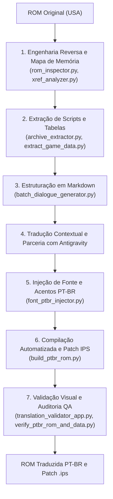

# 🕹️ GBA ROMs Translator PT-BR — Toolkit & Suite de Localização

> [!NOTE]
> ### ⚖️ Aviso Legal / Fan Project Disclaimer
> - **Projeto de Fãs Sem Fins Lucrativos:** Este é um projeto voluntário desenvolvido exclusivamente por e para a comunidade de fãs, com objetivos puramente educacionais, de pesquisa em engenharia reversa e preservação da história dos videogames. Nenhuma cobrança financeira é realizada pelo uso deste material.
> - **Não Disponibilização de ROMs:** Este repositório **NÃO contém, NÃO hospeda e NÃO disponibiliza nenhum arquivo de ROM (.gba) comercial ou protegido por direitos autorais**. O usuário deve obrigatoriamente possuir e fornecer sua própria cópia física/digital original legalmente adquirida.
> - **Apenas Ferramentas e Patches:** Distribuímos estritamente código-fonte de utilitários e patches de modificação (`.ips`), que contêm apenas as diferenças de texto traduzido e rotinas desenvolvidas pelos fãs.
> - **Propriedade Intelectual:** Todos os títulos de jogos, artes, marcas comerciais, personagens e trilhas sonoras originais pertencem aos seus respectivos proprietários de copyright (Nintendo, Flight-Plan, Banpresto, Atlus, Konami, etc.).

---

Repositório central de ferramentas modulares, scripts de engenharia reversa e pipelines automatizados para extração, tradução e injeção de textos em ROMs de **Game Boy Advance (GBA)** para Português do Brasil (PT-BR).

Este ambiente foi projetado para operar com **localização sem limites de texto** (reconstrução de ponteiros e realocação de memória) e possui suporte nativo para fluxo de trabalho em par com o **Antigravity (Google DeepMind)**.

---

> [!IMPORTANT]
> ### ⚠️ Escopo do Projeto e Imagens com Texto
> No projeto atual de **Summon Night: Swordcraft Story 1**, a localização cobre **100% dos textos do jogo**: diálogos de história principal, conversas de NPCs, nomes e descrições de armas, itens, magias, bestiário, materiais e menus dinâmicos renderizados via fontes de texto.
> 
> **Não foram traduzidas imagens com textos**, tais como o logotipo da tela inicial/abertura (Title Screen), telas de intervalo estáticas e gráficos comprimidos do menu principal desenhados como sprites/tilesets fixos. A ferramenta [`menu_graphics_ptbr.py`](jogos/Summon_Night_Swordcraft_Story_1/tools/menu_graphics_ptbr.py) e o extrator [`extract_all_graphics.py`](jogos/Summon_Night_Swordcraft_Story_1/tools/extract_all_graphics.py) estão incluídos no repositório como base técnica para quem desejar realizar a edição gráfica tile-a-tile no futuro.

---

## 📂 Estrutura do Repositório

```
gba-roms-translator-ptbr/
│
├── 📁 protocolo_extracao/        # 📜 PROTOCOLO OFICIAL DE EXTRAÇÃO E LOCALIZAÇÃO
│   ├── PROTOCOLO_MESTRE_EXTRACAO.md # Diretrizes completas, regras de VRAM e multi-console
│   ├── README.md                 # Guia rápido de uso e comandos da suíte
│   ├── 📁 templates/             # Modelos oficiais de arquivos .md (Glossário, Sistema, Itens...)
│   └── 📁 tools/                 # Ferramentas automáticas (Métricas, Detector de ROM, Imagens, Token Economy)
│       ├── metrics_analyzer.py        # Análise estatística de limites de caracteres e overflow
│       ├── rom_feature_detector.py    # Varredura de cabeçalho, vídeos (Mobiclip) e compressão
│       ├── image_text_auditor.py      # Catalogação e auditoria de integridade de imagens
│       └── token_optimizer_batcher.py # Fatiador com injeção cirúrgica de contexto para IA
│
├── 📁 _ferramentas_gerais/       # Softwares utilitários independentes de jogo
│   ├── mGBA/                    # Emulador de alta precisão com depurador integrado
│   └── crystaltile2/            # Editor hexadecimal e visualizador de tiles/paletas GBA
│
├── 📁 jogos/                     # Diretórios individuais de cada ROM
│   │
│   ├── 📁 Summon_Night_Swordcraft_Story_1/  # [v0.2.5] 100% dos textos traduzidos e auditados
│   │   ├── ARQUIVOS md/         # Textos traduzidos em Markdown (Lotes 01 a 06 e Tabelas)
│   │   ├── docs/                # Mapeamento técnico de memória e auditoria da ROM
│   │   ├── extracted/           # Pacotes JSON de tradução e dados extraídos
│   │   ├── releases/            # Patches de tradução distribuíveis (.ips v0.1, v0.2, v0.2.5)
│   │   ├── tools/               # Scripts de engenharia, fontes e rebuild
│   │   ├── Compilar_ROM_PTBR.bat        # Compilação da ROM traduzida em 1 clique
│   │   ├── Iniciar_Validador_Traducao.bat # Interface visual de validação no navegador
│   │   ├── CHANGELOG.md         # Histórico de versões e marcos
│   │   └── VERSION.json         # Controle semântico de versão da tradução
│   │
│   ├── 📁 Summon_Night_Swordcraft_Story_2/  # [Em Andamento] Lotes 01 a 18 extraídos
│   │   ├── ARQUIVOS md/         # Diálogos e menus extraídos
│   │   ├── releases/            # Patch v0.1 inicial
│   │   └── tools/               # Suíte de extração e tradução
│   │
│   ├── 📁 Summon_Night_Swordcraft_Story_3/  # [Estrutura Inicial] Preparação de ambiente
│   │
│   └── 📁 _MODELO_NOVO_JOGO/    # Template oficial padronizado com o Protocolo v1.0
│       ├── ARQUIVOS md/         # Templates essenciais (Glossário, Sistema, Itens, Personagens...)
│       ├── docs/                # Relatório de extração padrão
│       ├── releases/            # Destino dos patches gerados
│       ├── tools/               # Scripts específicos da ROM
│       └── README.md            # Guia passo a passo com o Protocolo
│
├── .gitignore                   # Proteção rigorosa contra versionamento de ROMs comerciais e zips
└── README.md                    # Esta documentação
```

---

## 🛠️ Catálogo Completo das Ferramentas

Todas as ferramentas do repositório foram escritas em Python 3 e foram concebidas de forma modular. Abaixo está o catálogo técnico detalhado de cada ferramenta:

### 0. Protocolo de Extração de ROMs e Token Economy (`protocolo_extracao/`)

| Arquivo | Finalidade Técnica |
| :--- | :--- |
| [`PROTOCOLO_MESTRE_EXTRACAO.md`](protocolo_extracao/PROTOCOLO_MESTRE_EXTRACAO.md) | **Especificação Mestre do Protocolo.** Define as regras para organização textual em Markdown, estudo de métricas de caracteres, catálogo de personagens com biografia híbrida (in-game + web), regras de VRAM para imagens com texto, detecção de vídeos e matriz de expansão multi-console (SNES, Mega Drive, NDS, PS1). |
| [`metrics_analyzer.py`](protocolo_extracao/tools/metrics_analyzer.py) | **Analisador Estatístico de Métricas de Caracteres.** Analisa arquivos Markdown de diálogo, calculando médias de caracteres por linha, percentis e sinalizando linhas com potencial risco de transbordamento (*overflow*) antes da compilação. |
| [`rom_feature_detector.py`](protocolo_extracao/tools/rom_feature_detector.py) | **Detector de Recursos e Fingerprint de ROM.** Identifica cabeçalhos oficiais, codecs de vídeo FMV (Mobiclip `MOC4`/`MOC5`, Actimagine), compressões de BIOS (LZ77, Huffman, RLE) e tabelas sequenciais de ponteiros de 32 bits. |
| [`image_text_auditor.py`](protocolo_extracao/tools/image_text_auditor.py) | **Auditor e Catalogador Gráfico.** Gera a planilha de controle de imagens com texto (`controle-de-imagens-com-texto.md`) e audita PNGs editados para impedir alterações indevidas de dimensões ou corrupção da cor 0 da paleta (transparência de hardware). |
| [`token_optimizer_batcher.py`](protocolo_extracao/tools/token_optimizer_batcher.py) | **Fatiador com Injeção Cirúrgica de Contexto (Token Economy).** Divide lotes longos em blocos enxutos de 30-50 falas e injeta *exclusivamente* os termos de glossário e personagens ativos no trecho, economizando até 75% dos tokens em requisições a LLMs. |

### 1. Compilação e Geração de Patches

| Arquivo | Finalidade Técnica |
| :--- | :--- |
| [`build_ptbr_rom.py`](jogos/Summon_Night_Swordcraft_Story_1/tools/build_ptbr_rom.py) | **Compilador Central da ROM.** Lê a ROM original, carrega os arquivos Markdown traduzidos (`ARQUIVOS md/`), reconstrói os blocos binários de script (PSI3), atualiza a tabela global de ponteiros de 32-bit, aplica a fonte acentuada PT-BR, aplica patches ASM no motor do jogo e gera tanto a ROM traduzida (`.gba`) quanto o patch IPS pronto para lançamento em `releases/`. |

### 2. Validação Visual e Garantia de Qualidade (QA)

| Arquivo | Finalidade Técnica |
| :--- | :--- |
| [`translation_validator_app.py`](jogos/Summon_Night_Swordcraft_Story_1/tools/translation_validator_app.py) | **Servidor Web Local de Validação.** Inicia uma API local leve que se conecta à interface visual, permitindo busca de qualquer linha de diálogo, contagem de caracteres por linha, validação de quebras `<br>` e recompilação imediata da ROM diretamente pela web. |
| [`validator_ui.html`](jogos/Summon_Night_Swordcraft_Story_1/tools/validator_ui.html) | **Interface Gráfica Interativa.** Simula a caixa de diálogo do Game Boy Advance com preview pixel art em tempo real, alertando o tradutor caso o texto ultrapasse a largura da janela (overflow). |
| [`verify_ptbr_rom_and_data.py`](jogos/Summon_Night_Swordcraft_Story_1/tools/verify_ptbr_rom_and_data.py) | **Auditoria Automatizada de Integridade.** Compara os bytes gravados na ROM gerada com os dados originais e com o JSON de tradução, verificando se todos os ponteiros de menus, textos de combate e diálogos estão 100% íntegros e sem corrupção de memória. |

### 3. Engenharia Reversa e Motores de Script

| Arquivo | Finalidade Técnica |
| :--- | :--- |
| [`psi3_rebuilder.py`](jogos/Summon_Night_Swordcraft_Story_1/tools/psi3_rebuilder.py) | **Reconstrutor do Motor de Script PSI3.** Usado pela Flight-Plan/Banpresto. Desmonta o bytecode binário dos eventos e diálogos, recalcula ponteiros relativos internos de jumps/condicionais e remonta os pacotes de script com tamanhos dinâmicos, permitindo textos maiores que os originais. |
| [`psi3_opcode_scanner.py`](jogos/Summon_Night_Swordcraft_Story_1/tools/psi3_opcode_scanner.py) | **Mapeador de Instruções do Script.** Analisa blocos de dados para identificar opcodes da máquina virtual do jogo (comandos de impressão de texto, pausas `<wait>`, quebras de caixa `<br>`, chamadas de variáveis de nome `<hero>` e bifurcações lógicas). |
| [`psi3_inspector.py`](jogos/Summon_Night_Swordcraft_Story_1/tools/psi3_inspector.py) | **Inspetor de Metadados de Scripts.** Analisa a estrutura interna de arquivos `.psi3` individuais, exibindo contadores de diálogos, ponteiros de início de bloco e tamanhos de cabeçalho. |
| [`archive_extractor.py`](jogos/Summon_Night_Swordcraft_Story_1/tools/archive_extractor.py) | **Extrator de Contêineres e Descompressor LZ77.** Extrai os sub-arquivos binários da ROM, com rotina de descompressão LZ77 padrão BIOS GBA (tipo `0x10`), gerando arquivos individuais para análise. |
| [`xref_analyzer.py`](jogos/Summon_Night_Swordcraft_Story_1/tools/xref_analyzer.py) | **Analisador de Referências Cruzadas (Xrefs).** Varre a ROM à procura de ponteiros Little-Endian de 32-bit (`0x08XXXXXX`) que apontam para strings e tabelas de dados, permitindo descobrir onde as rotinas do jogo lêem os textos. |
| [`disasm_boot.py`](jogos/Summon_Night_Swordcraft_Story_1/tools/disasm_boot.py) | **Desmontador de Inicialização ARM/Thumb.** Analisa o código executável dos primeiros bancos da ROM, mapeando rotinas de inicialização, chamada de descompressão e cópia da ROM para a WRAM. |

### 4. Tipografia, Fontes e Gráficos

| Arquivo | Finalidade Técnica |
| :--- | :--- |
| [`font_ptbr_injector.py`](jogos/Summon_Night_Swordcraft_Story_1/tools/font_ptbr_injector.py) | **Injetor de Glifos Acentuados PT-BR.** Injeta os caracteres `á, é, í, ó, ú, ã, õ, â, ê, ô, à, ç, Á, É...` na tabela de tiles de fonte do GBA (substituindo símbolos japoneses ou caracteres especiais sem uso) e aplica patches em código ASM para evitar que o jogo bloqueie caracteres acentuados. |
| [`menu_graphics_ptbr.py`](jogos/Summon_Night_Swordcraft_Story_1/tools/menu_graphics_ptbr.py) | **Injetor de Gráficos de Menu.** Ferramenta de compressão e injeção de tiles 4bpp/8bpp comprimidos com LZ77 para gráficos de menus e HUD. |
| [`extract_all_graphics.py`](jogos/Summon_Night_Swordcraft_Story_1/tools/extract_all_graphics.py) | **Extrator Gráfico em Lote.** Localiza blocos de tiles na ROM e extrai como imagens PNG indexadas usando paletas de cores do jogo. |

### 5. Extração e Estruturação de Textos

| Arquivo | Finalidade Técnica |
| :--- | :--- |
| [`extract_game_data.py`](jogos/Summon_Night_Swordcraft_Story_1/tools/extract_game_data.py) | **Extrator Estruturado de Tabelas.** Extrai dados fixos da ROM: catálogo de armas (espadas, machados, lanças, socadeiras, brocas), itens consumíveis, materiais de forja, magias e bestiário/inimigos para formato legível (JSON e Markdown). |
| [`batch_dialogue_generator.py`](jogos/Summon_Night_Swordcraft_Story_1/tools/batch_dialogue_generator.py) | **Gerador e Sincronizador de Diálogos.** Agrupa os milhares de scripts extraídos e monta tabelas estruturadas em Markdown (`ARQUIVOS md/`), separadas por lotes de dias e capítulos da história. |
| [`text_locator.py`](jogos/Summon_Night_Swordcraft_Story_1/tools/text_locator.py) | **Localizador de Sequências de Texto.** Faz varreduras na ROM procurando por strings em ASCII, Shift-JIS ou tabelas de codificação personalizadas (`.tbl`). |
| [`sjis_script_dumper.py`](jogos/Summon_Night_Swordcraft_Story_1/tools/sjis_script_dumper.py) | **Dumper de Texto Shift-JIS.** Extrai diálogos e textos que estejam em codificação japonesa Shift-JIS preservando tags e quebras. |

### 6. Ferramentas Utilitárias e de Apoio (`_ferramentas_gerais/`)

* **mGBA** (`_ferramentas_gerais/mGBA/`): Emulador oficial utilizado para depuração em tempo real, visualização de VRAM, mapeamento de memória em execução e testes com save files.
* **CrystalTile2** (`_ferramentas_gerais/crystaltile2/`): Editor hexadecimal clássico com suporte a visualização direta de padrões gráficos de GBA/NDS (tiles 1bpp, 2bpp, 4bpp, 8bpp) e importação de tabelas de caracteres (`.tbl`).

---

## 📖 Como as Ferramentas Foram Usadas no Projeto Summon Night 1

O projeto de localização de **Summon Night: Swordcraft Story 1** seguiu um fluxo de engenharia reversa e tradução estruturado em 6 etapas:



### Passo 1: Mapeamento de Memória e Referências Cruzadas
* Utilizou-se o [`rom_inspector.py`](jogos/Summon_Night_Swordcraft_Story_1/tools/rom_inspector.py) e o [`xref_analyzer.py`](jogos/Summon_Night_Swordcraft_Story_1/tools/xref_analyzer.py) para analisar a ROM original (`AB4E`).
* Descobriu-se que a ROM continha **636.97 KB de espaço livre contínuo** preenchido com `0x00` entre `0x08760C21` e `0x087FFFFF`.
* Isso permitiu a estratégia de **realocação de ponteiros sem limite rígido de caracteres**, dispensando abreviações forçadas. Toda a análise foi documentada em [`docs/architecture.md`](jogos/Summon_Night_Swordcraft_Story_1/docs/architecture.md).

### Passo 2: Extração e Descompressão
* O [`archive_extractor.py`](jogos/Summon_Night_Swordcraft_Story_1/tools/archive_extractor.py) descompactou os contêineres de dados da ROM via algoritmo LZ77.
* O motor de script proprietário PSI3 foi desvendado com o [`psi3_opcode_scanner.py`](jogos/Summon_Night_Swordcraft_Story_1/tools/psi3_opcode_scanner.py), identificando opcodes de texto, pausas e quebras de janela.

### Passo 3: Extração de Tabelas e Geração dos Arquivos Markdown
* O [`extract_game_data.py`](jogos/Summon_Night_Swordcraft_Story_1/tools/extract_game_data.py) extraiu todo o acervo de armas, itens, magias, materiais e monstros para tabelas legíveis.
* O [`batch_dialogue_generator.py`](jogos/Summon_Night_Swordcraft_Story_1/tools/batch_dialogue_generator.py) organizou todas as falas da história e de exploração em pastas de lotes dentro de `ARQUIVOS md/`:
  - `00` a `07`: Contexto, glossário, menus e tabelas de catálogo.
  - `08` a `11`: Diálogos do prólogo e Capítulo 1.
  - `Lote_01` a `Lote_06`: Diálogos completos de exploração dos Dias 01 a 12, História Principal até o final e pós-jogo.

### Passo 4: Adaptação Tipográfica e Caracteres Acentuados
* Como as ROMs de GBA em inglês não possuem caracteres acentuados latinos na VRAM, o [`font_ptbr_injector.py`](jogos/Summon_Night_Swordcraft_Story_1/tools/font_ptbr_injector.py) desenhou os glifos (`á, é, í, ó, ú, ã, ç...`) diretamente nos tiles da fonte original do jogo e aplicou patches em instruções ASM da engine para liberar a renderização desses bytes.

### Passo 5: Compilação e Geração do Patch IPS
* O script [`build_ptbr_rom.py`](jogos/Summon_Night_Swordcraft_Story_1/tools/build_ptbr_rom.py) faz o build completo: lê os Markdowns traduzidos, recompila os blocos PSI3 via [`psi3_rebuilder.py`](jogos/Summon_Night_Swordcraft_Story_1/tools/psi3_rebuilder.py), recalibra os ponteiros de memória, grava a ROM em português e gera automaticamente o patch IPS na pasta `releases/`.

### Passo 6: Validação de Qualidade e Preview Visual
* Com o [`translation_validator_app.py`](jogos/Summon_Night_Swordcraft_Story_1/tools/translation_validator_app.py), qualquer fala pode ser testada com visualização fidedigna à tela do GBA, garantindo que o texto nunca ultrapasse a largura da caixa de diálogo.
* O script [`verify_ptbr_rom_and_data.py`](jogos/Summon_Night_Swordcraft_Story_1/tools/verify_ptbr_rom_and_data.py) realizou a auditoria final de ponteiros e integridade binária.

---

## 🤖 Como Utilizar este Toolkit com o Antigravity (Google DeepMind)

O Antigravity é o assistente ideal para atuar como seu **par programador (Pair Programmer)** e **tradutor especializado** em ROM Hacking. Veja como utilizar a inteligência artificial para traduzir uma nova ROM de GBA:

### 1. Preparando uma Nova ROM para Tradução

1. Dentro da pasta `jogos/`, copie a pasta template `_MODELO_NOVO_JOGO` e renomeie-a para o nome do novo jogo (exemplo: `jogos/Castlevania_Aria_of_Sorrow/` ou `jogos/Summon_Night_2/`).
2. Coloque a ROM original limpa (`.gba`) dentro da subpasta `rom/`.
3. Abra o chat do Antigravity na raiz deste repositório.

### 2. Exemplos de Prompts para o Antigravity

#### 🔍 Etapa 1: Análise e Mapeamento da ROM
Envie para o Antigravity:
> *"Antigravity, adicionei a ROM de [Nome do Jogo] na pasta `jogos/[Nome_Da_Pasta]/rom/`. Analise o cabeçalho da ROM, calcule a entropia dos bancos de memória, localize onde estão os ponteiros de 32 bits usando o `xref_analyzer.py` e crie a documentação técnica inicial em `docs/architecture.md`."*

O Antigravity executará os scripts de inspeção no terminal PowerShell, identificará os offsets dos textos e documentará a área livre para expansão.

#### 📜 Etapa 2: Extração dos Textos para Markdown
Envie para o Antigravity:
> *"Com base nos offsets identificados, adapte o extrator de textos para essa ROM e gere os arquivos Markdown na pasta `ARQUIVOS md/`, organizando por menus, itens e diálogos com suas respectivas tags de controle (`<br>`, `<wait>`)."*

O Antigravity criará as tabelas estruturadas prontas para tradução.

#### ✍️ Etapa 3: Tradução Contextual e Padronização
Envie para o Antigravity:
> *"Traduza o arquivo `ARQUIVOS md/04-armas.md` para Português do Brasil mantendo o tom natural e medieval do jogo. Preserve rigorosamente todas as tags de controle e respeite o limite de 32 caracteres por linha na caixa de diálogo."*

O Antigravity fará a tradução contextual e idiomática, mantendo glossários consistentes e respeitando os comandos técnicos.

#### 🔤 Etapa 4: Configuração da Fonte PT-BR
Envie para o Antigravity:
> *"Verifique a tabela de caracteres e os tiles de fonte dessa ROM. Use o `font_ptbr_injector.py` para mapear os caracteres acentuados PT-BR nos tiles livres e aplique os patches necessários no código da engine."*

#### 🚀 Etapa 5: Compilação e Geração do Patch
Envie para o Antigravity:
> *"Execute a compilação da ROM traduzida através de `build_ptbr_rom.py`, valide a integridade com `verify_ptbr_rom_and_data.py` e gere o patch IPS em `releases/`."*

---

## ⚡ Guia Rápido de Uso Local

### Pré-requisitos
* **Python 3.10 ou superior** instalado no sistema.
* Windows com PowerShell ou CMD.

### Comandos Rápidos (Summon Night 1)

1. **Compilar a ROM PT-BR e Gerar o Patch IPS:**
   ```powershell
   cd "jogos/Summon_Night_Swordcraft_Story_1"
   python tools/build_ptbr_rom.py
   ```
   *(Ou simplesmente dê um duplo clique no arquivo `Compilar_ROM_PTBR.bat`)*

2. **Abrir o Validador Visual no Navegador:**
   ```powershell
   cd "jogos/Summon_Night_Swordcraft_Story_1"
   python tools/translation_validator_app.py
   ```
   *(Ou dê um duplo clique em `Iniciar_Validador_Traducao.bat`. O navegador abrirá automaticamente em `http://localhost:8080`)*

3. **Auditar a Integridade da ROM:**
   ```powershell
   python tools/verify_ptbr_rom_and_data.py
   ```

4. **Testar no Emulador:**
   Abra a ROM gerada `Summon Night - Swordcraft Story (PT-BR).gba` diretamente no mGBA disponível em `_ferramentas_gerais/mGBA/mGBA.exe`.

---

## 📜 Licença e Termos de Uso

* **Código e Ferramentas:** Disponibilizados sob licença livre para fins educacionais, preservação de jogos e projetos sem fins lucrativos da comunidade de ROM Hacking.
* **ROMs e Direitos Autorais:** Nenhuma ROM comercial protegida por direitos autorais é distribuída neste repositório. O usuário deve fornecer sua própria cópia legal do jogo original. As traduções são distribuídas exclusivamente na forma de patches (`.ips`).
