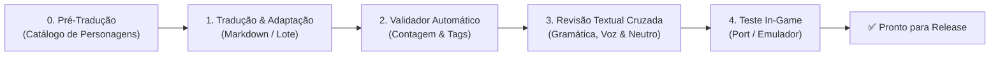

# 📜 Protocolo Oficial de Tradução e Localização (PT-BR)
**Projeto:** Summon Night: Swordcraft Story (GBA)  
**Versão:** 1.2.0 — Diretriz Canônica  
**Status:** Vital / Mandatório para todos os lotes de tradução e revisão  

---

## 🎯 1. Filosofia e Missão da Localização

A tradução deste projeto não é uma mera substituição literal de palavras do inglês para o português, mas sim um processo de **localização cultural e imersiva**. O objetivo é proporcionar ao jogador brasileiro a mesma experiência emocional, cômica e dramática planejada pelos desenvolvedores japoneses originais, respeitando o jargão do universo de *Summon Night*, a naturalidade da língua portuguesa e os limites técnicos rigorosos do hardware do Game Boy Advance.

---

## 🏛️ 2. Diretrizes Vitais do Projeto (Requisitos Centrais)

### 2.0. Fase 0: Pré-Tradução Obrigatória — Criação do Catálogo de Personagens (`catalogo-de-personagens.md`)
> [!IMPORTANT]
> **REGRA DE OURO DA PRÉ-TRADUÇÃO:** É expressamente **PROIBIDO** iniciar a tradução de diálogos de qualquer lote sem antes preencher e consultar o **Catálogo de Personagens**.

A criação do catálogo na pré-tradução garante que:
1. Nenhuma personagem caia na "voz neutra/pasteurizada" de tradução automática.
2. Cada falante tenha seu grau de formalidade, vocabulário e maneirismos fixados antes do texto começar.
3. As relações de tratamento (apelidos, pronomes, reverência a mestres) sejam uniformes em todos os lotes.
4. O assistente de IA receba o contexto dramático exato dos personagens ativos em cada cena.

---

### 2.1. Localização por Classes, Papéis e Perfis de Personagens
Cada personagem possui uma voz única (*character voice*), um vocabulário característico e um nível de formalidade próprio:

*   **Mestres e Lordes (Ex: Mestre Bron, Sakuro, Lubert, Kouren):**
    *   *Tom:* Paternal, rústico, solene ou autoritário.
    *   *Linguagem:* Firme, experiente, sem gírias infantis. Bron usa termos de oficina ("martelar", "têmpera", "açoite do fogo"), com repreensões carinhosas, mas severas.
*   **Protagonista (Cleru / Pratty):**
    *   *Tom:* Jovem aprendiz dedicado, impulsivo, corajoso e entusiasmado.
    *   *Linguagem:* Coloquial limpa, ágil, enérgica, respeitosa com superiores e calorosa com amigos e rivais.
*   **Feras Guardiãs (Vozes Distintas por Criatura):**
    *   **Sugar (Sapureth - Fada/Anjo):** Mimada, extremamente apegada e apaixonada pelo protagonista. Usa termos afetuosos ("meu bem", "queridinho", "amorzinho"), fala rápida e suspiros dramáticos.
    *   **Rasho (Silturn - Oni):** Rebelde, impetuoso, cabeça-quente, fala como um guerreiro delinquente que valoriza honra e porrada. Usa termos diretos, desafiadores e pouca paciência para frescuras.
    *   **Zante / Zantek (Loreilal - Mecânico):** Racional, analítico, formal, fala com precisão quase matemática e fidelidade incondicional.
    *   **Kutty (Maetropa - Bestial):** Expressa-se por vocalizações ("Kuu!", "Kutty-kutty!"), acompanhadas de reações físicas ou pensamentos traduzidos de forma infantil e fofa.
*   **Rivais (Ex: Sanary, Varil, Razzy):**
    *   *Sanary:* Nobre, arrogante, provocadora, postura de elite da Guilda Dourada.
    *   *Razzy:* Garota atlética, direta, franca, enérgica.
    *   *Varil:* Solene, compenetrado, peso da responsabilidade nas costas.
*   **NPCs Comuns e Marinheiros:**
    *   Falam como artesãos e moradores de cidade portuária; fala informal, calorosa e prática.

---

### 2.2. Neutralidade de Gênero Sistêmica
> [!IMPORTANT]
> Em *Summon Night: Swordcraft Story*, o jogador escolhe entre **Cleru (masculino)** ou **Pratty (feminina)**, mas centenas de caixas de diálogo da ROM utilizam o **mesmo ponteiro de texto** compartilhado para ambos.

Para evitar quebras de imersão ("Você foi muito corajoso" quando jogando com Pratty), o texto deve adotar **sintaxe neutra e epicena** sempre que se referir ao protagonista:

*   **Evitar adjetivos e particípios flexionados:**
    *   ❌ *Errado:* "Você é muito talentoso!" / "Você está cansado?"
    *   ✅ *Correto:* "Você tem muito talento!" / "O cansaço bateu?" / "Já está sem energia?"
*   **Reformular com construções verbais e substantivos:**
    *   ❌ *Errado:* "Fique atento, novato!"
    *   ✅ *Correto:* "Preste atenção nisso!" / "Muita atenção agora!"
*   **Agradecimentos e Cumprimentos:**
    *   ❌ *Errado:* "Obrigado/Obrigada!"
    *   ✅ *Correto:* "Muito obrigado!" (se o falante for fixo masculino) ou frases universais: "Agradeço de coração!", "Valeu!", "Meus agradecimentos!"
*   **Diálogos entre Protagonista e Fera Guardiã:**
    *   Dar preferência a referências diretas pelo nome `{PLAYER}` ou pronomes que funcionam em ambos os gêneros ("você", "minha dupla").

---

### 2.3. Eliminação Total do Inglês (Exceção: Apenas Nomes Próprios)
*   **Tolerância zero para resquícios de inglês:** Nenhuma palavra de interface, sistema, habilidade, tela de vitória (*"Victory", "Level Up", "Guard", "Equip"*) ou fala incidental deve permanecer em inglês.
*   **O que permanece original:**
    *   **Nomes Próprios de Personagens:** Cleru, Pratty, Bron, Amar, Sanary, Varil, Sugar, Rasho, Lubert, Sakuro, Shintetsu, etc.
    *   **Nomes Próprios de Nações/Mundos:** Lyndbaum, Silturn, Sapureth, Maetropa, Loreilal.
    *   **Nomes Próprios de Regiões:** Wystern, Mirana, Kagro, Rugista.
*   **Nomes Compostos com Tradução Obrigatória:**
    *   *Silver Guild* $\rightarrow$ **Guilda Prateada**
    *   *Gold Guild* $\rightarrow$ **Guilda Dourada**
    *   *Central Tower* $\rightarrow$ **Torre Central**
    *   *Marine Dungeon* $\rightarrow$ **Labirinto Marinho**
    *   *Cape Lighthouse* $\rightarrow$ **Farol do Cabo**
    *   *City of Swords* $\rightarrow$ **Cidade das Espadas**

---

### 2.4. Coerência Narrativa e Terminológica Unificada
*   Um termo, arma, material ou local não pode ter dois nomes diferentes ao longo da história.
*   Se o mineral inicial é chamado de **Minério de Ferro**, ele jamais deve aparecer como "Minério Férrico" ou "Iron Ore" nos capítulos seguintes.
*   Se uma técnica se chama **Corte Veloz**, essa designação deve ser mantida nos diálogos, nas caixas de notificação `{VAR_2}` e nos menus de batalha.
*   A equipe e as IAs devem seguir rigorosamente a matriz do glossário oficial.

---

### 2.5. Política Rígida de Abreviações
*   **Nos Diálogos (História, Eventos, Conversas casuais):**
    *   🚫 **ABSOLUTAMENTE PROIBIDAS.**
    *   Nunca usar contrações informais de internet ou abreviações técnicas (`vc`, `pq`, `tb`, `q`, `p/`, `esp.`, `rec.`).
    *   Se a frase estiver longa demais para a caixa de diálogo, ela deve ser **reescrita com vocabulário mais conciso**, e nunca mutilada com pontos de abreviação.
*   **Nas Telas de Menus, Itens, Equipamentos e Sistema:**
    *   ✅ **PERMITIDAS E REGULAMENTADAS.**
    *   Devido às limitações de largura de colunas (máximo de 8 a 16 caracteres para nomes de itens e 2 linhas de 26 a 30 caracteres para descrições), as abreviações devem seguir o padrão canônico da Seção 3.3.

---

### 2.6. Termos Adaptados: Estratégia de Introdução vs. Uso Comum

| Termo Original | 1ª Apresentação (Lore / Solene / Tutorial) | Uso Corriqueiro nos Diálogos | Uso em Menus e UI | Motivo da Adaptação |
| :--- | :--- | :--- | :--- | :--- |
| **Craftlord** | **Lorde da Forja** *(ou Mestre-Ferreiro)* | **Lorde** / **Mestre** | **Lorde** | Economiza até 10 caracteres por ocorrência. |
| **Craftknight** | **Cavaleiro-Ferreiro** *(ou Forjador)* | **Ferreiro** / **Forjador** | **Forjador** | Evita travamento de leitura em frases de ação. |
| **Guardian Beast** | **Fera Guardiã** | **Guardião** / **Parceiro** | **Guardião** | Mais fluido e fácil de flexionar. |
| **Summon Beast / Creature** | **Criatura Invocada** | **Invocação** / **Criatura** | **Invocação** | Reduz de 17 para 9 caracteres. |
| **Stray Summon ("Stray")** | **Invocação Errante** | **Errante** | **Errante** | Elimina repetição pesada nos diálogos de masmorra. |
| **Mystic Ore** | **Minério Místico** | **Minério Místico** | **Min. Místico** | Padrão claro. |
| **Summonite** | **Pedra de Invocação (Summonite)** | **Summonite** | **Summonite** | Mineral com nome próprio estabelecido no universo. |

---

### 2.7. Tipos de Técnicas de Armas (*Weapon Types*)

| Termo Original (EN-US) | Menu de Técnicas / Forja | Diálogos da História | Observações de Métrica |
| :--- | :--- | :--- | :--- |
| **`Sword Type`** | **`Espada`** | **`Técnica com Espada`** | Uso conciso no menu e natural na narrativa. |
| **`Axe Type`** | **`Machado`** | **`Técnica com Machado`** | Respeita limite de 35 caracteres por linha. |
| **`Spear Type`** | **`Lança`** | **`Técnica com Lança`** | Evita anglicismos e termos soltos. |
| **`Knuckle Type`** | **`Soqueira`** | **`Técnica com Soqueira`** | Padronizado para socos/garras/manoplas. |
| **`Drill Type`** | **`Broca`** | **`Técnica com Broca`** | Categoria mecânica exclusiva do universo. |

---

## ⚡ 3. Pilares Críticos Técnicos (Limitações de Hardware)

### 3.1. Métricas Técnicas de Tela e Quebra de Linhas no GBA
*   **Hard Limit:** **36 caracteres por linha** (Teto operacional absoluto da engine).
*   **Zonas de Segurança:**
    *   🟢 **1 a 32 caracteres:** Ideal e 100% seguro contra encostar nas bordas.
    *   🟡 **33 a 35 caracteres:** Atenção. Só aceitável se contiver letras finas (`i`, `l`, `t`, `!`, `.`).
    *   🔴 **36+ caracteres:** **Proibido.** Risco de corte de texto (overflow) ou texto invisível fora da moldura.
*   **Altura da Caixa de Diálogo:**
    *   A caixa padrão suporta no máximo **2 a 3 linhas** por avanço.
    *   Sempre use quebra manual (` ` ou código de controle) em pontos sintáticos naturais.
    *   **Proibição de Orfandade:** Nunca deixe artigos (`o`, `a`, `um`), pronomes ou preposições (`de`, `em`) isolados no final de uma linha.

---

### 3.2. Proteção Rígida de Tags e Variáveis da Engine
As variáveis dinâmicas inseridas pelo código ASM do jogo não podem ser modificadas nem traduzidas:

| Tag | Função na ROM | Regra Gramatical de Uso |
| :--- | :--- | :--- |
| `{PLAYER}` | Nome do protagonista (Cleru / Pratty) | Nunca coloque artigo direto colado se variar em gênero. Use: *"Ei, {PLAYER}!"* em vez de *"O {PLAYER}"*. |
| `{PARTNER}` | Nome da Fera Guardiã | Manter o nome puro da fera chamada. |
| `{SIBLING}` | Substituído por "Maninho" / "Maninha" | Ajustar concordância para frases carinhosas. |
| `{VAR_2}` | Nome da técnica ou item aprendido | Não anexar prefixos que choquem com o gênero da técnica. |
| `{VAR_4}` | Nome da magia invocada | Exemplo: *"Aprendeu {VAR_4}!"* |
| `{MASTER}` | Nome do mestre/invocador antigo | Usar sem alterações. |

---

### 3.3. Tabela Canônica de Abreviações para Menus e Itens

| Palavra / Conceito | Abreviação Padronizada | Exemplo de Aplicação |
| :--- | :---: | :--- |
| **Ataque / Poder de Ataque** | `ATQ` | `ATQ +15` |
| **Defesa** | `DEF` | `DEF +8` |
| **Agilidade / Velocidade** | `AGI` | `AGI +5` |
| **Durabilidade** | `DUR` | `DUR 120/120` |
| **Pontos de Vida** | `HP` | `Recup. 50 HP` |
| **Recuperação / Recupera** | `Recup.` | `Recup. HP e Status` |
| **Especial** | `Esp.` | `Ataque Esp.` |
| **Elemento / Elemental** | `Elem.` | `Dano Elem. Fogo` |
| **Espada / Machado / Lança** | `Esp.` / `Mach.` / `Lanç.` | `Esp. de Ferro` |
| **Minério** | `Min.` | `Min. de Ferro` |
| **Nível** | `Nv.` | `Nv. 12` |
| **Andar (Floor)** | `A` | `Torre Central 2A` |

---

### 3.4. Tipografia, Pontuação e Onomatopeias Naturais
*   **Reticências:** Utilizar sempre três pontos comuns (`...`) sem espaço antes.
*   **Travessão e Aspas:** Diálogos com ênfase interna utilizam aspas duplas `"..."`.
*   **Onomatopeias:** Adaptar do japonês/inglês para a sonoridade brasileira:
    *   *Sigh* $\rightarrow$ *Ufa...* / *Ai, ai...*
    *   *Gulp* $\rightarrow$ *Glup!*
    *   *Clank / Clang* $\rightarrow$ *Clang!* / *Trom!*
    *   *Gah! / Argh!* $\rightarrow$ *Argh!* / *Droga!*
    *   *Huh?* $\rightarrow$ *Hã?* / *Hein?*
    *   *Yikes!* $\rightarrow$ *Eita!* / *Caramba!*

---

## 🔄 4. Ciclo de Qualidade e Validação em 5 Etapas (QA)

---

## 📌 5. Checklist Rápido do Tradutor / Revisor

- [ ] O **Catálogo de Personagens** foi previamente consultado antes de traduzir a fala?
- [ ] A frase respeita o limite de **32 a 35 caracteres por linha**?
- [ ] O texto soa natural para um falante nativo de português brasileiro?
- [ ] Se o jogador estiver com **Pratty**, a frase funciona perfeitamente sem soar masculina?
- [ ] Há alguma palavra em inglês sobrando que não seja nome próprio?
- [ ] As tags como `{PLAYER}` e `{PARTNER}` estão intactas?
- [ ] Foi eliminada qualquer abreviação do diálogo?
- [ ] O termo adaptado foi usado corretamente (ex: *Lorde* ou *Mestre* no lugar de *Craftlord*)?
- [ ] O tipo de técnica foi adaptado corretamente (*Técnica com Espada*, etc.)?
