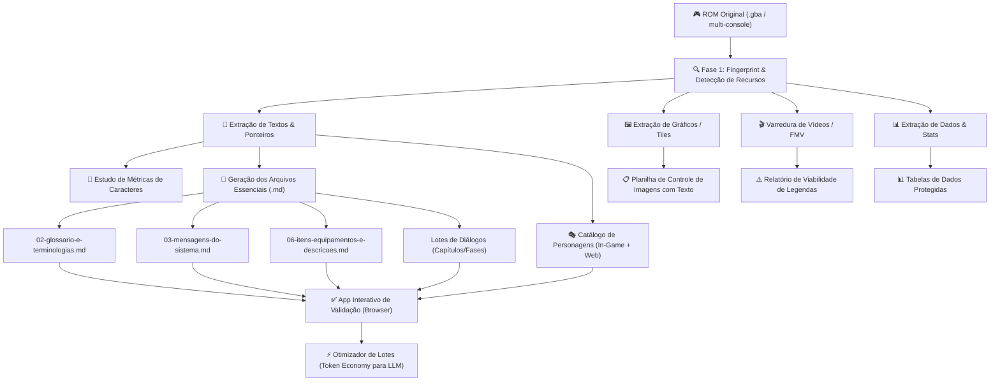
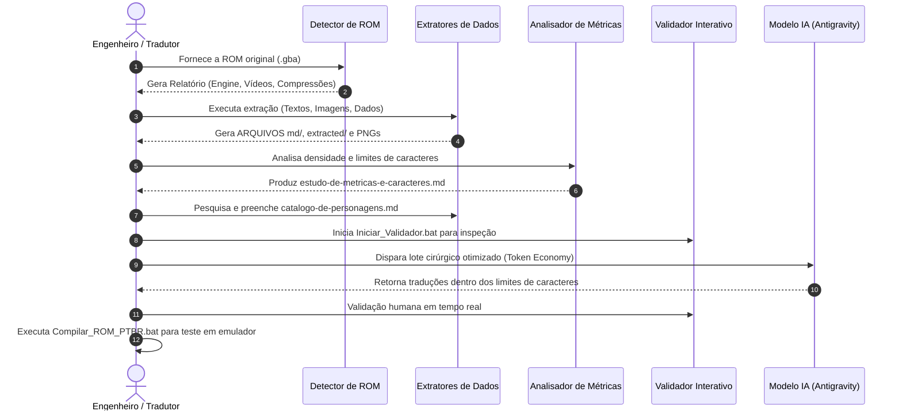

# 📜 Protocolo Mestre de Extração para Tradução de ROMs
**Versão:** 1.0.0  
**Escopo Primário:** Game Boy Advance (GBA)  
**Arquitetura:** Modular & Extensível (Suporte futuro planejado para SNES, Mega Drive, NDS e PS1)  
**Ambiente Integrado:** Suíte GBA ROMs Translator PT-BR & Antigravity (Google DeepMind)

---

## 🎯 1. Visão Geral e Filosofia do Protocolo

A extração de dados de uma ROM é a etapa de maior impacto em todo o ciclo de vida de uma tradução de videogame. Um processo de extração desestruturado gera:
1. **Desperdício massivo de tokens** ao interagir com Modelos de Linguagem (LLMs), enviando código de máquina ou contextos desnecessários.
2. **Inconsistência terminológica**, onde nomes de locais, personagens e itens variam entre capítulos.
3. **Erros de quebra de tela (overflow)**, causados pela falta de estudo prévio dos limites de caracteres por linha da caixa de diálogo original.
4. **Perda de identidade de personagens**, que passam a falar com a mesma voz neutra ou robótica.
5. **Esquecimento de textos embutidos em imagens e vídeos**, descobertos apenas no final do projeto.

Este protocolo padroniza as instruções, especificações de arquivos e ferramentas automáticas para que qualquer ROM possa ser dissecada, organizada e disponibilizada de forma enxuta, padronizada e 100% compatível com a suíte de validação interativa.



---

## ⚡ 2. Diretrizes de Economia de Tokens (Token Economy)

Para garantir máxima agilidade e evitar o consumo desnecessário de tokens de contexto em interações com Inteligência Artificial, o protocolo estipula as seguintes regras invioláveis:

### 2.1. O Princípio do Contexto Cirúrgico (*Surgical Context*)
- **Proibido enviar dumps brutos ou blocos binários para LLMs**: Arquivos binários, opcodes brutos ou despejos hexadecimais completos consomem dezenas de milhares de tokens sem agregar inteligência de localização.
- **Divisão em Lotes Funcionais (*Chunking*)**: Os diálogos devem ser fatiados em lotes lógicos de **30 a 50 caixas de diálogo por interação** (aproximadamente 1.500 a 3.000 tokens por prompt). Lotes menores mantêm o foco do modelo no ápice de sua atenção (`needle-in-a-haystack`).
- **Injeção Dinâmica de Glossário**: O prompt de tradução não deve conter o glossário inteiro do jogo. O utilitário [`token_optimizer_batcher.py`](tools/token_optimizer_batcher.py) pré-escaneia o lote, identifica quais termos do glossário e quais personagens aparecem no trecho e injeta **apenas** essas entradas no prompt.

### 2.2. Saída Delta Padronizada
- As respostas da IA devem retornar exclusivamente as colunas editáveis da tabela Markdown (`Tradução Sugerida` e opcionalmente `Alternativa`), indexadas pelo ID do script ou offset original.
- Elimina-se a necessidade de o modelo reescrever colunas estáticas de metadados, economizando até 60% dos tokens de geração.

---

## 📝 3. Pilar 1 — Protocolo de Textos e Diálogos

### 3.1. Organização Estrutural e Arquivos Obrigatórios
Toda extração textual deve gerar, obrigatoriamente, a seguinte estrutura de arquivos Markdown dentro do diretório `ARQUIVOS md/`:

| Arquivo Obrigatório | Propósito e Conteúdo | Compatibilidade com Validador |
| :--- | :--- | :---: |
| `02-glossario-e-terminologias.md` | Todos os nomes próprios, cidades, termos de lore, nomes de magias, títulos, e variáveis dinâmicas de engine (`{PLAYER}`, `{PARTNER}`, `{ITEM}`). Base de consulta terminológica. | Sim |
| `03-mensagens-do-sistema.md` | Menus principais, interface de batalha, avisos de sistema ("Salvar?", "Carregando..."), configurações e telas de erro. | Sim |
| `06-itens-equipamentos-e-descricoes.md` | Arsenal completo: espadas, machados, armaduras, consumíveis, itens-chave e suas respectivas descrições de inventário. | Sim |
| `catalogo-de-personagens.md` | Fichas biográficas completas de protagonistas, aliados, rivais e NPCs secundários (in-game + web). | Informativo / Base de Tom |
| `estudo-de-metricas-e-caracteres.md` | Relatório matemático da largura de caixa de diálogo, tamanho da fonte, teto em caracteres do original e limites em PT-BR. | Informativo / QA |
| `Lote_XX_Nome_Do_Arco/` | Pastas de lotes contendo arquivos numerados sequencialmente (ex: `08-dialogos-cap1.md`), divididos por capítulo, fase, dia ou missão. | Sim |

### 3.2. Formato de Tabela Compatível com o Validador
Para integração com o [`translation_validator_app.py`](../jogos/Summon_Night_Swordcraft_Story_1/tools/translation_validator_app.py), as tabelas de diálogos devem seguir rigorosamente o padrão:

```markdown
| Script / Offset | Personagem / Contexto | Texto Original (EN-US) | Tradução Sugerida (PT-BR) | Status |
| :--- | :--- | :--- | :--- | :---: |
| `+0x058E`–`0x0612` | **Mestre Bron** | `Whoa, not so fast! Go forge that`<br>`last weapon I taught ya before`<br>`moving on to the next!` | `Opa, não tão rápido! Vá forjar`<br>`aquela última arma que te ensinei`<br>`antes de passar para a próxima!` | ⏳ Pendente |
```

E para itens/equipamentos:
```markdown
| ID / Offset | Nome Original (EN-US) | Nome Sugerido (PT-BR) | Descrição Original (EN-US) | Descrição Sugerida (PT-BR) | Status |
| :--- | :--- | :--- | :--- | :--- | :---: |
| `0x01` / `0x081D00` | `Iron Sword` | `Espada de Ferro` | `A sturdy sword forged`<br>`from raw iron ore.` | `Uma espada resistente`<br>`forjada de minério bruto.` | ⏳ Pendente |
```

> [!IMPORTANT]
> - Linhas de uma mesma caixa de diálogo devem ser separadas exclusivamente pela tag `<br>`.
> - O status deve iniciar sempre como `⏳ Pendente` e, após revisão humana no app validador ou compilação, é atualizado para `✅ Validado`.

---

### 3.3. Estudo de Métricas de Caracteres por Linha de Diálogo

O Português do Brasil (PT-BR) expande estruturalmente o texto em **15% a 30%** em comparação com o Inglês (EN-US) e em **100% a 250%** em comparação com o Japonês (JA-JP) devido à natureza de palavras polissilábicas e artigos definidos/indefinidos.

#### A. Parâmetros Físicos do GBA
- **Resolução Nativa:** 240 x 160 pixels.
- **Caixa de Diálogo Típica:** Altura de 40 a 64 pixels, largura útil de **208 a 224 pixels** (descontando bordas de 8 a 16 pixels de cada lado).
- **Tipografia:**
  - *Fonte Monoespaçada (Fixed Width 8x8 ou 8x12):* Cada caractere ocupa exatos 8 pixels. Uma caixa com 208 pixels suporta no máximo **26 caracteres por linha** (`208 / 8 = 26`).
  - *Fonte Proporcional (Variable Width Font - VWF):* Caracteres têm larguras variáveis (ex: 'i' = 3px, 'm' = 7px, 'A' = 6px, espaço = 3px). Média de 5,5 a 6,2 pixels por caractere, permitindo entre **32 a 38 caracteres por linha**.

#### B. Metodologia de Cálculo de Limites
Para cada jogo extraído, o script de análise [`metrics_analyzer.py`](tools/metrics_analyzer.py) deve ser executado sobre o dump textual bruto para gerar a tabela de métricas:

1. **Original Character Metric:**
   - Contagem média de caracteres por linha original ($C_{orig}$).
   - Contagem máxima observada em qualquer linha do original ($Max_{orig}$).
   - Número padrão de linhas por caixa de diálogo (usualmente 2 ou 3 linhas).
2. **Definição dos Limites de Tradução (Target Limits):**
   - **Soft Limit (Recomendado):** Folga estética de 2 a 3 caracteres antes da borda da caixa para evitar sensação de aperto visual.
   - **Hard Limit (Teto Físico):** Número máximo absoluto de pixels/caracteres antes do texto cortar na borda direita ou transbordar para fora da janela (overflow).
3. **Fórmula de Estimativa:**
   $$\text{Hard Limit PT-BR} \le \left\lfloor \frac{\text{Largura Útil da Janela (px)}}{\text{Largura Média do Glifo PT-BR (px)}} \right\rfloor$$

---

### 3.4. Catálogo de Personagens e NPCs (Biografia Híbrida)

A tradução de RPGs e jogos com narrativa rica exige que a IA ou o tradutor humano compreenda a **voz** e o **registro de fala** de cada indivíduo.

#### Metodologia de Composição da Biografia Híbrida:
1. **Dados In-Game:**
   - Nomes em tabelas da ROM.
   - Primeira aparição e contexto narrativo.
   - Retratos faciais associados (expressões de raiva, alegria, tristeza).
2. **Pesquisa Web Canônica Vetted:**
   - Consulta a fontes oficiais e de referência (Wikis especializadas da franquia, guias oficiais japoneses - *Koushiki Memorial Books*, manuais impressos originais).
3. **Ficha Cadastral Padrão do Catálogo:**
   - **Nome Original (JP/EN) e Nome PT-BR adotado.**
   - **Arquétipo / Papel:** Protagonista, Guardião, Vilão, Mentor, Comerciante, Alívio Cômico.
   - **Gênero e Faixa Etária:** Crucial para concordância gramatical em português (masculino/feminino/neutro).
   - **Perfil Psicológico & Tom de Voz:**
     - *Nível de Formalidade:* Fala em tom erudito, coloquial, infantil ou arcaico?
     - *Idioleto & Maneirismos:* Possui bordões, tiques verbais (ex: terminar frases com partículas sonoras, falar de si na terceira pessoa), sotaques regionais ou gírias?
     - *Relações Interpessoais:* Como se dirige a superiores (respeitoso, submisso) vs amigos (intimista, zombeteiro) vs inimigos (desafiador, sarcástico).

---

## 🖼️ 4. Pilar 2 — Protocolo de Imagens e Gráficos com Texto

Muitos jogos concentram textos críticos fora do script principal, desenhados diretamente em tilesets gráficos:
- Telas de Título (*Press Start*, *New Game*, *Continue*)
- Telas de Fim de Jogo (*Game Over*)
- Botões e Abas de Menus e Inventários
- Mapas Mundi com nomes de regiões
- Telas de Introdução Estáticas e Ilustrações de Prólogo/Epílogo

```
┌────────────────────────────────────────────────────────────────┐
│  PASSO A PASSO: PIPELINE DE IMAGENS COM TEXTO                 │
├────────────────────────────────────────────────────────────────┤
│  1. DUMP COMPLETO ──> Extrair todos os tiles/sprites para PNG  │
│  2. AUDITORIA     ──> Filtrar imagens contendo caracteres/texto │
│  3. CATALOGAÇÃO   ──> Registrar na Planilha de Controle (.md)  │
│  4. EDIÇÃO PIXEL  ──> Redesenhar respeitando tiles, limites e 4bpp│
│  5. REINJEÇÃO     ──> Inserir na ROM mantendo ponteiros e VRAM │
└────────────────────────────────────────────────────────────────┘
```

### 4.1. Regras Invioláveis para Edição de Imagens com Texto:
1. **Restrição de Geometria e Tilemap:** O texto traduzido deve caber rigorosamente nas dimensões em pixels originais da imagem. Nunca expanda a resolução da imagem em pixels sem reescrever a rotina de desenho e alocação de VRAM do jogo.
2. **Índice 0 da Paleta:** No hardware de GBA e consoles retrô, **a cor 0 da paleta é sempre reservada para a transparência**. Desenhar sobre o índice 0 fará com que partes da letra fiquem invisíveis ou transparentes.
3. **Preservação de Formato de Cor:**
   - Gráficos 4bpp: Exatamente 16 cores por subtileza.
   - Gráficos 8bpp: Exatamente 256 cores.
   - Arquivos editados devem ser salvos em PNG indexado com a mesma tabela de cores do original.
4. **Planilha de Controle de Imagens:** Toda imagem com texto deve ser registrada no arquivo `controle-de-imagens-com-texto.md` com status de tradução e teste em emulador.

---

## 🎬 5. Pilar 3 — Protocolo de Vídeos e FMVs

Embora menos frequentes em consoles com cartuchos de baixa capacidade, diversos títulos de GBA (e com maior frequência no NDS e PS1) possuem vídeos de abertura, finais animados ou cutscenes cinemáticas (ex: via motor Mobiclip / Actimagine, ou streams de tiles/áudio raw).

### 5.1. Detecção Automatizada
O protocolo estipula que toda extração execute uma varredura por assinaturas de multimídia na ROM:
- Assinaturas Mobiclip GBA: `MOC4`, `MOC5`, cabeçalhos Actimagine.
- Assinaturas de áudio streamado: Bancos ADPCM, streams PCM sequenciais.

### 5.2. Ações ao Detectar Vídeo:
1. **Emissão de Alerta Imediato:** O script de detecção gera um aviso no `relatorio-extracao.md` sinalizando o offset e tamanho estimado do fluxo de vídeo.
2. **Extração de Trilha e Frames:** O fluxo de vídeo é extraído para pasta temporária `extracted/videos/`.
3. **Estudo de Viabilidade de Legendagem:**
   - **Opção A — Hardsub (Re-renderização):** Requer recompactar os frames de vídeo com as legendas desenhadas em pixel art, utilizando codecs compatíveis com a engine do jogo sem estourar a taxa de dados (bitrate) suportada pelo cartucho.
   - **Opção B — Softsub / Text Overlay:** Análise de engenharia reversa para avaliar se é possível acionar uma interrupção de V-Blank e desenhar uma janela de texto OAM nativa sobre o plano de fundo do vídeo.

---

## 📊 6. Pilar 4 — Protocolo de Dados do Jogo (Game Data & Stats)

Além dos diálogos e histórias, jogos contêm tabelas binárias estáticas que precisam ser traduzidas para garantir 100% de imersão:
- Nomes e classes de Inimigos / Monstros / Chefes do Bestiário
- Nomes de Magias, Habilidades, Técnicas e seus parâmetros (Custo de MP, Elemento)
- Atributos de Personagens (Ataque, Defesa, Agilidade, Sorte, Pontos de Vida)
- Lojas, Preços, Tipos de Moeda e Índices de Raridade

### 6.1. Blindagem Estrutural
- Os dados devem ser extraídos para arquivos `.md` ou `.json` mantendo a **separação cirúrgica entre campos textuais (traduzíveis) e campos numéricos/ponteiros (imutáveis)**.
- O compilador deve validar se o comprimento em bytes do texto traduzido respeita a largura de campo fixa (ex: nomes de monstros limitados a 10 bytes com terminação nula). Se o nome traduzido for maior, o sistema deve acionar a rotina de realocação de ponteiros para o espaço estendido da ROM.

---

## 🔄 7. Ciclo Operacional Passo a Passo (Do Dump à Tradução)



---

## 🌐 8. Matriz de Extensibilidade Multi-Console

Embora o Game Boy Advance seja a plataforma prioritária, o protocolo foi concebido em camadas desacopladas para permitir expansão imediata para outras plataformas:

| Plataforma | Resolução / VRAM | Formato de Fonte Típico | Formatos Gráficos | Desafio Específico de Extração |
| :--- | :--- | :--- | :--- | :--- |
| **GBA** | 240x160 / 96KB VRAM | 1bpp/2bpp/4bpp (Mono ou VWF) | Tiles 8x8 (4bpp/8bpp), BIOS LZ77, Huffman | Arquitetura ARM32/Thumb16; ponteiros de 32 bits (`0x08XXXXXX`). |
| **SNES** | 256x224 / 64KB VRAM | 1bpp/2bpp monoespaçado | Tiles 8x8 (2bpp/4bpp/8bpp), RLE/LZ proprietários | Mapeamento LoROM/HiROM de 24 bits; bancos de 64KB (65C816). |
| **Mega Drive** | 320x224 / 64KB VRAM | 1bpp monoespaçado | Tiles 8x8 (4bpp), Nemesis, Kosinski, Saxman | Processador 68000; ponteiros Big-Endian; paletas de 4x16 cores. |
| **NDS** | 2x 256x192 / 656KB VRAM | Fontes estruturadas NFTR / RTFN | Sistema de arquivos interno (NARC / SDAT), Mobiclip VX | Arquitetura dual ARM9/ARM7; arquivos em árvore compactada. |
| **PS1** | 320x240 a 640x480 / 1MB VRAM | Fontes em texturas TIM | Imagens TIM, Vídeos MDEC (STR), Áudio XA | Sistema de arquivos ISO 9660; ponteiros de 32 bits Little-Endian (MIPS). |

---

## 🚀 9. Como Utilizar este Protocolo

1. Toda nova tradução iniciada deve adotar a estrutura de pastas e os templates contidos em `protocolo_extracao/templates/`.
2. Execute o `metrics_analyzer.py` sobre os diálogos logo após o primeiro dump bruto para calibrar os limites antes de qualquer tradução.
3. Preencha o `catalogo-de-personagens.md` com apoio de pesquisas web canônicas antes de traduzir os lotes de história.
4. Utilize o `token_optimizer_batcher.py` para gerar prompts de IA com a máxima densidade informacional e menor custo de tokens.
5. Inicie a validação interativa com o validador para aprovação linha a linha em tempo real.
