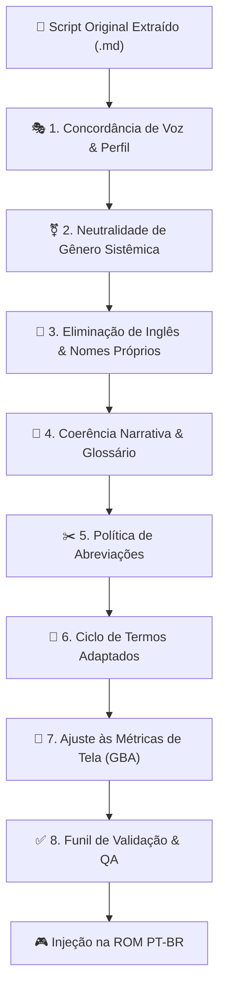

# 📜 Protocolo Mestre de Tradução e Localização de ROMs (PT-BR)
**Versão:** 1.1.0  
**Escopo Primário:** Game Boy Advance (GBA) & Consoles Retrô (SNES, Mega Drive, NDS, PS1)  
**Ambiente Integrado:** Suíte GBA ROMs Translator PT-BR & Antigravity (Google DeepMind)  
**Status:** Vital e Mandatório para todos os lotes de tradução e revisão  

---

## 🎯 1. Filosofia e Missão da Localização

A tradução de jogos clássicos em nosso framework não é uma mera substituição literal de palavras do idioma de origem (inglês/japonês) para o português, mas sim um processo de **localização cultural, técnica e imersiva**.

O objetivo primordial é entregar ao jogador de língua portuguesa:
1. **Imersão Narrativa Total:** Sensação de que o jogo foi concebido nativamente em português brasileiro.
2. **Respeito Estrito à Identidade da Obra:** Manutenção do tom emocional, cômico ou dramático idealizado pelos desenvolvedores originais.
3. **Harmonia com o Hardware:** Respeito absoluto aos limites de memória VRAM, largura de caixas de diálogo, tabelas de caracteres e variáveis da engine.

---

## 🏛️ 2. Diretrizes Vitais de Tradução (Pilares Centrais)

### 2.1. Localização por Classes, Papéis e Perfis de Personagens (*Character Voice*)
Cada personagem ou classe social deve possuir uma identidade vocal marcante, diferenciada por seu grau de instrução, idade, origem e papel na história:

*   **Mestres, Nobres e Autoridades:**
    *   *Tom:* Paternal, solene, experiente ou austero.
    *   *Linguagem:* Firme, elegante, vocabulário rico, sem gírias efêmeras. Artesãos usam metáforas de sua profissão (ex: "martelar", "temperar o aço", "fogo da forja").
*   **Protagonistas Jovens e Aprendizes:**
    *   *Tom:* Impulsivo, corajoso, determinado, bem-humorado.
    *   *Linguagem:* Coloquial limpa, ágil, direta, respeitosa com seus superiores e calorosa com aliados.
*   **Aliados Mágicos e Entidades Especiais:**
    *   Diferenciar rigorosamente criaturas solenes (linguagem arcaica ou matemática) de criaturas infantis, fadas emotivas (afetuosas, dengosas) ou guerreiros impetuosos (linguagem desafiadora e direta).
*   **Rivais:**
    *   Alternar entre arrogância nobre, competitividade franca e orgulho ferido, evitando caricaturas vazias.
*   **NPCs Comuns e Marinheiros:**
    *   Falam como o povo da cidade; linguagem informal, expressiva, acolhedora e prática.

---

### 2.2. Neutralidade de Gênero Sistêmica
> [!IMPORTANT]
> Em RPGs de GBA onde o jogador pode escolher o gênero do protagonista ou onde scripts de diálogo são reutilizados para múltiplos eventos, centenas de caixas de texto compartilham o **mesmo ponteiro de memória**.

O protocolo determina a utilização de **sintaxe neutra e epicena** para todas as referências diretas ao protagonista em caixas compartilhadas:

*   **Substituição de particípios e adjetivos por construções verbais:**
    *   ❌ *Incorreto:* "Você foi muito rápido e corajoso!"
    *   ✅ *Correto:* "Você agiu com muita rapidez e coragem!"
    *   ❌ *Incorreto:* "Você está cansado?"
    *   ✅ *Correto:* "O cansaço bateu?" / "Já está sem fôlego?"
    *   ❌ *Incorreto:* "Você é muito habilidoso!"
    *   ✅ *Correto:* "Você tem uma habilidade impressionante!"
*   **Agradecimentos Universais:**
    *   ❌ *Incorreto:* "Obrigado/a"
    *   ✅ *Correto:* "Meus agradecimentos!", "Agradeço de coração!", "Valeu!", "Muito obrigado!" (apenas quando o falante for inequivocamente homem fixo).
*   **Evitar Choque de Artigo com Variáveis:**
    *   ❌ *Incorreto:* "O {PLAYER} chegou!"
    *   ✅ *Correto:* "Olha só quem chegou: {PLAYER}!" / "{PLAYER} acaba de chegar!"

---

### 2.3. Eliminação Total do Inglês (Localização Integral — Manter Apenas Nomes Próprios)
*   **Tolerância Zero:** Nenhum resquício de língua inglesa deve permanecer em qualquer elemento do jogo. A localização abrange 100% dos textos textuais e estruturados:
    *   **Diálogos e Narrativa:** Falas de NPCs, tutoriais, prólogos, epílogos e escolhas.
    *   **Interface e Menus:** Comandos de combate, telas pós-batalha (*Vitória, Subiu de Nível, Equipar, Defender, Fugir*).
    *   **Armas, Equipamentos e Acessórios:** Todos os nomes de espadas, machados, lanças, soqueiras, brocas, escudos e anéis devem ser traduzidos para o português (*Metal Saber* $\rightarrow$ **Sabre de Metal**; *Grand Saber* $\rightarrow$ **Grão-Sabre**; *Amateur Knife* $\rightarrow$ **Faca de Aprendiz**).
    *   **Itens, Consumíveis e Minérios:** Ervas, poções, pedras mágicas e matérias-primas (*Healing Herb* $\rightarrow$ **Erva Medicinal**; *Iron Ore* $\rightarrow$ **Minério de Ferro**; *Antidote Ore* $\rightarrow$ **Minério Antídoto**).
    *   **Bestiário, Monstros e Chefes:** Todos os inimigos comuns e chefes compostos devem ser traduzidos e adaptados (*Slime* $\rightarrow$ **Gosma**; *Mud Boxer* $\rightarrow$ **Lutador de Lama**; *Evil Spirit* $\rightarrow$ **Espírito Maligno**; *Iron Giant* $\rightarrow$ **Gigante de Ferro**).
    *   **Magias, Habilidades e Efeitos Especiais:** Golpes, combos, feitiços de invocação e status (*Water Slash* $\rightarrow$ **Corte Aquático**; *2 Hit Combo* $\rightarrow$ **Combo de 2 Golpes**).
*   **Critério Exclusivo para Nomes Próprios (Permanecem Originais):**
    *   Nomes próprios de personagens fictícios (*Cleru, Pratty, Edgar, Aera, Blaire, Orin, Ryouga, Bron, Amar, Sanary, Varil, Lubert, etc.*).
    *   Nomes próprios de Feras Guardiãs e Deuses/Demônios (*Sugar, Rasho, Zantek, Kutty, EXeLD, Dinah, Arno, Loki, Goura*).
    *   Nomes de continentes, reinos ou dimensões fantasia (*Silturn, Sapureth, Loreilal, Maetropa, Lyndbaum*).
    *   Nomes geográficos de cidades e ilhas sem significado descritivo comum (*Kagro, Mirana, Rugista, Wystern*).
*   **Nomes Compostos e Descritivos com Tradução Obrigatória:**
    *   Elementos geográficos, masmorras ou organizações compostos por substantivos/adjetivos comuns **devem ser 100% traduzidos**:
        *   *Silver Guild* $\rightarrow$ **Guilda Prateada**
        *   *Gold Guild* $\rightarrow$ **Guilda Dourada**
        *   *Central Tower* $\rightarrow$ **Torre Central**
        *   *Marine Dungeon* $\rightarrow$ **Labirinto Marinho**
        *   *Cape Lighthouse* $\rightarrow$ **Farol do Cabo**
        *   *City of Swords* $\rightarrow$ **Cidade das Espadas**
        *   *Cliff Village* $\rightarrow$ **Vila do Penhasco**
        *   *Entry Woods* $\rightarrow$ **Bosque da Entrada**
        *   *Goura's Gate* $\rightarrow$ **Portão de Goura**
        *   *Subterranean Canal* $\rightarrow$ **Canal Subterrâneo**
        *   *Fire Fortress* $\rightarrow$ **Fortaleza de Fogo**
        *   *Ruined Factory* $\rightarrow$ **Fábrica em Ruínas**
        *   *Daemon Vault* $\rightarrow$ **Câmara do Demônio**

---

### 2.4. Coerência Narrativa e Terminológica Unificada
*   **Fonte Única da Verdade:** Toda a tradução deve obedecer rigorosamente ao arquivo de Glossário do projeto (`02-glossario-e-terminologias.md`).
*   Se um item, material ou monstro foi nomeado no Capítulo 1, ele **jamais** poderá receber uma variação sinônima nos capítulos posteriores.
*   Termos de mecânica (nomes de status, atributos, elementos e técnicas) devem ser idênticos no diálogo, na interface de batalha e nas notificações do sistema.

---

### 2.5. Política Rígida de Abreviações
*   **Nos Diálogos (História, Conversas com NPCs, Eventos):**
    *   🚫 **PROIBIÇÃO ABSOLUTA.**
    *   É estritamente proibido o uso de abreviações técnicas ou internetês (`vc`, `pq`, `tb`, `q`, `p/`, `esp.`, `atq.`, `rec.`).
    *   Se a frase ultrapassar o limite da caixa, deve ser **reformulada com palavras mais concisas**, mantendo a naturalidade literária. Jamais mutile palavras em caixas de diálogo.
*   **Nas Telas de Menus, Equipamentos e Sistema:**
    *   ✅ **PERMITIDAS CONFORME TABELA OFICIAL.**
    *   Devido aos limites físicos de colunas (geralmente entre 8 e 16 caracteres para nomes e 2 linhas para descrições), abreviações são obrigatórias, mas devem seguir a tabela canônica do framework.

---

### 2.6. Ciclo de Vida dos Termos Adaptados
Termos conceituais próprios do universo do jogo que resultam em expressões longas em português devem seguir um ciclo de 3 fases para balancear ambientação e economia de caracteres:

| Fase | Contexto de Aplicação | Regra de Uso | Exemplo de Aplicação |
| :--- | :--- | :--- | :--- |
| **Fase 1: Introdução** | 1ª aparição, tutoriais, lore oficial e momentos solenes | Tradução completa e explicativa | *"Craftlord"* $\rightarrow$ **Lorde da Forja** *"Craftknight"* $\rightarrow$ **Cavaleiro-Ferreiro** *"Stray Summon"* $\rightarrow$ **Invocação Errante** |
| **Fase 2: Diálogo Comum** | Conversas cotidianas, ritmo rápido de ação | Forma adaptada e enxuta | **Lorde**, **Mestre**, **Ferreiro**, **Forjador**, **Errante**, **Guardião** |
| **Fase 3: Interface & Menus** | Listas de status, tabelas de títulos e menus | Forma sintetizada ou sigla oficial | **Lorde**, **Forjador**, **Errante** |

---

## ⚡ 3. Pilares Técnicos de Engenharia e Hardware

### 3.1. Métricas de Tela e Quebra de Linhas no GBA
*   **Hard Limit:** **36 caracteres por linha** (Teto operacional absoluto antes do corte visual pela moldura do GBA).
*   **Zonas de Segurança:**
    *   🟢 **1 a 32 caracteres:** Ideal (leitura fluida e sem risco).
    *   🟡 **33 a 35 caracteres:** Atenção (permitido apenas se contiver glifos finos como `i`, `l`, `t`, pontuação).
    *   🔴 **36+ caracteres:** **Crítico (Proibido)** — Exige quebra manual (` `) ou reescrita concisa.
*   **Prevenção de Orfandade Textual:**
    *   Nunca isole monossílabos (`o`, `a`, `de`, `em`, `e`) no final de uma linha de diálogo quando a quebra seguinte separar o termo de seu núcleo.

---

### 3.2. Proteção Rígida de Tags e Variáveis da Engine
As variáveis dinâmicas injetadas pelo código ASM (`{PLAYER}`, `{PARTNER}`, `{SIBLING}`, `{VAR_2}`, `{VAR_4}`, `{MASTER}`) são intocáveis:
*   **Jamais altere a caixa, a grafia ou os delimitadores das chaves `{}` ou tags `<>`.**
*   Construa a frase ao redor da tag para que o resultado sonoro seja perfeito independentemente do valor preenchido em tempo de execução.

---

### 3.3. Tabela Canônica de Abreviações para Menus e Itens

| Conceito / Termo | Abreviação Padronizada | Exemplo Prático |
| :--- | :---: | :--- |
| **Ataque / Poder de Ataque** | `ATQ` | `ATQ +15` |
| **Defesa** | `DEF` | `DEF +8` |
| **Agilidade / Velocidade** | `AGI` | `AGI +5` |
| **Durabilidade** | `DUR` | `DUR 120/120` |
| **Pontos de Vida** | `HP` | `Recup. 50 HP` |
| **Recuperação / Recupera** | `Recup.` | `Recup. HP de aliado` |
| **Especial** | `Esp.` | `Técnica Esp.` |
| **Elemento / Elemental** | `Elem.` | `Ataque Elem. Fogo` |
| **Espada / Machado / Lança** | `Esp.` / `Mach.` / `Lanç.` | `Esp. de Ferro` |
| **Soqueira / Broca** | `Soq.` / `Broc.` | `Soq. de Aço` |
| **Minério** | `Min.` | `Min. de Ferro` |
| **Nível** | `Nv.` | `Nv. 25` |
| **Andar (Floor)** | `A` | `Torre Central 2A` |

---

### 3.4. Tipografia, Pontuação e Onomatopeias Brasileiras
*   **Reticências:** Sempre utilizar 3 pontos comuns (`...`) sem espaço antes.
*   **Onomatopeias:** Adaptar do japonês/inglês para o padrão cômico e expressivo brasileiro:
    *   *Sigh* $\rightarrow$ *Ufa...* / *Ai, ai...*
    *   *Gulp* $\rightarrow$ *Glup!*
    *   *Clank / Clang* $\rightarrow$ *Clang!* / *Trom!*
    *   *Gah! / Argh!* $\rightarrow$ *Argh!* / *Droga!*
    *   *Huh?* $\rightarrow$ *Hã?* / *Hein?*
    *   *Yikes!* $\rightarrow$ *Eita!* / *Caramba!*

---

### 3.5. Métricas Comparativas e Matriz Cross-Game (Estudo de Caso: SN1 vs SN2)

A aplicação do framework de tradução entre jogos consecutivos da mesma franquia exige um mapeamento meticuloso de densidade e estruturas na ROM:

| Parâmetro de Engenharia | Summon Night: Swordcraft Story 1 | Summon Night: Swordcraft Story 2 | Impacto Operacional no Processo |
| :--- | :---: | :---: | :--- |
| **Tamanho da ROM** | 8 MB (`0x800000`) | **16 MB** (`0x1000000`) | Expansão de espaço livre para scripts relocados. |
| **Volume de Diálogos** | ~35.000 linhas | **45.318 linhas** | Crescimento de 30% no escopo e número de eventos. |
| **Scripts de Cena / Evento**| 100 scripts (Arch 0/1) | **2.544 scripts** (Arch 2) | Uso de tabela de alocação de 16 bytes relativos na VM PSI3. |
| **Limite por Linha de Diálogo**| 36 caracteres | **36 caracteres** | **Zona Segura:** 1-32 chars \| **Atenção:** 33-35 chars \| **Crítico:** 36+ chars. |
| **Quebra de Linha** | ` ` | ` ` | Quebra manual estrita entre as linhas da mesma caixa. |
| **Tags de Engine Dinâmicas** | `{PLAYER}`, `{PARTNER}`, `{SIBLING}`, `{MASTER}`, `{VAR_2}` | `{PLAYER}`, `{PARTNER}`, `{SIBLING}`, `{MASTER}`, `{VAR_2}`, `{VAR_4}` | Sintaxe neutra e flexibilidade gramatical ao redor da tag. |
| **Armas no Catálogo** | 130 armas | **213 armas** | Stride de 132 bytes; 100% dos nomes e descrições localizados em PT-BR. |
| **Itens e Materiais** | 120 itens | **156 itens** | Stride de 132 bytes; consumíveis, minérios e acessórios em PT-BR. |
| **Magias e Técnicas** | 32 magias | **95 técnicas / magias** | 40 magias (stride 112) + 25 combos (stride 74) + 30 efeitos especiais. |
| **Bestiário (Monstros/Chefes)**| 88 monstros | **114 monstros** | Stride de 184 bytes; nomes e descrições de até 4 linhas 100% em PT-BR. |
| **Diretriz de Nomes Próprios** | Preservados (*Cleru, Pratty, Bron*) | Preservados (*Edgar, Aera, Blaire*) | Preservação restrita a pessoas, feras e mundos fantasia (*Silturn, etc.*). |

---

## 🔄 4. Funil de Qualidade e Validação em 4 Etapas (QA)

Nenhum arquivo traduzido deve ser mesclado à ROM final sem cumprir o fluxo:

1.  **Etapa 1 — Tradução & Localização:** Tradução orientada pelo perfil, neutralidade e termos adaptados.
2.  **Etapa 2 — Validador Automatizado:** Execução das ferramentas de auditoria e métricas para detectar linhas acima de 35 caracteres, tags corrompidas e resquícios de inglês.
3.  **Etapa 3 — Revisão Textual Cruzada:** Leitura em voz alta para validar fluidez, pontuação e naturalidade dramática.
4.  **Etapa 4 — Teste In-Game:** Verificação em emulador (mGBA) ou port nativo para auditar quebras de linha e renderização gráfica real.

---

## 📌 5. Checklist Rápido de Liberação de Lote

Antes de aprovar qualquer lote traduzido:
- [ ] Todas as linhas de diálogo respeitam a margem de **32 a 35 caracteres**?
- [ ] A linguagem soa natural para um falante nativo de português brasileiro?
- [ ] Frases compartilhadas funcionam perfeitamente sem flexão masculina indesejada?
- [ ] Todo texto em inglês foi eliminado (mantendo apenas nomes próprios)?
- [ ] As tags dinâmicas como `{PLAYER}` e `{PARTNER}` estão intactas?
- [ ] Diálogos estão livres de abreviações?
- [ ] Os termos adaptados foram introduzidos e usados de forma consistente?
